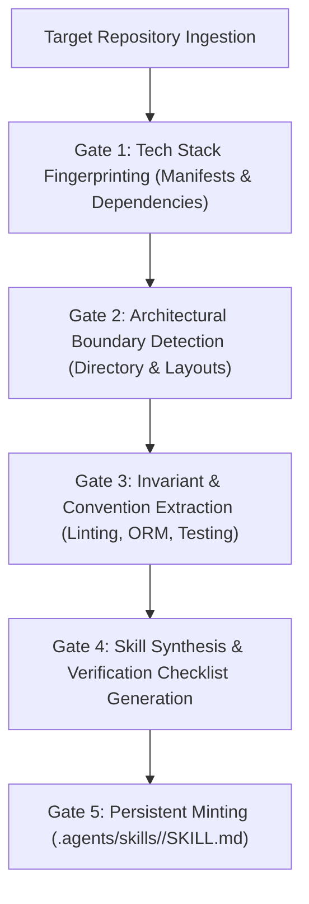

# Autonomous Project Skill Synthesis & Minting Engine (`/project-skills`)

> **Philosophy**: *Don't just write code—mint reusable project intelligence. When entering any repository, introspect its architectural invariants, framework idioms, and data contracts. Compile them into a persistent, living project skill that guarantees zero-shot fluency for all future agent turns.*

This skill establishes the **Skill Synthesis Protocol (SSP)**, enabling AI agents to autonomously build, mint, and update custom project-specific skills inside `.agents/skills/<project-name>/SKILL.md`.

---

## 1. Quick Navigation & Progressive Disclosure

| Resource Type | Document | Description |
| :--- | :--- | :--- |
| **Reference** | [references/skill-synthesis-protocol.md](references/skill-synthesis-protocol.md) | 4-stage synthesis lifecycle, structural requirements for minted skills. |
| **Reference** | [references/project-architecture-sensing.md](references/project-architecture-sensing.md) | Fingerprint detection matrix for Cargo, Go, Flutter, Hardhat, dbt. |
| **Utility** | [scripts/synthesize_project_skill.py](scripts/synthesize_project_skill.py) | CLI utility to introspect project manifests and mint persistent `.agents/skills/`. |

---

## 2. The Skill Synthesis Protocol (SSP) Workflow



1. **Gate 1: Tech Stack Fingerprinting**: Identify the runtime, core language, UI framework, ORM/database, and cloud targets by parsing project manifests (`package.json`, `pyproject.toml`, `pubspec.yaml`, `go.mod`).
2. **Gate 2: Architectural Boundary Detection**: Inspect top-level directory structures to determine organizational patterns (Hexagonal, Feature Slices, Next.js App Router, Layered MVC).
3. **Gate 3: Invariant & Convention Extraction**: Capture project-specific conventions (e.g., custom error classes, tenant scoping wrappers, naming patterns).
4. **Gate 4: Verification Checklist Compilation**: Build actionable verification commands (`npm test`, `pytest`, `cargo test`) and line limit checks directly into the skill.
5. **Gate 5: Persistent Minting**: Mint the synthesized skill directly into `.agents/skills/<project-name>/SKILL.md` with standard YAML frontmatter and strict 500-line compliance.

---

## 2. Anatomical Structure of a Synthesized Project Skill

Every synthesized project skill generated by `/project-skills` adheres to the strict SkillBuilder format:

```markdown
---
name: <project-name>-domain
description: Tailored architectural invariants, conventions, and verification gates for <project-name>.
---

# <Project Name> Domain Engineering Standard

> **Architecture**: <Detected Architecture Pattern>  
> **Primary Runtime**: <Node.js / Python / Go / Flutter>  
> **Persistence**: <PostgreSQL / SQLite / Supabase / Firestore>

---

## 1. Project Invariants & Non-Negotiables
- **Tenant Scoping**: All database queries must include tenant_id.
- **Route Boundaries**: Dynamic segments must provide loading and error boundaries.
- **Line Limit Ceiling**: Strictly enforce 500 lines per source file.

---

## 2. Architectural Directory Map
- \`src/features/\`: Encapsulated domain feature slices.
- \`src/core/\`: Shared utilities, error handlers, and telemetry.

---

## 3. Project Verification Checklist
Run prior to completing any task:
\`\`\`bash
<Detected test command>
<Detected build command>
\`\`\`
```

---

## 3. Project Skill Minter CLI

Autonomously analyze your current repository and mint a custom project skill:

```bash
# Mint a project skill for the current workspace
python3 skills/project-skills/scripts/synthesize_project_skill.py --path . --mint

# Output synthesized skill specification as JSON
python3 skills/project-skills/scripts/synthesize_project_skill.py --path . --json
```

Minted Outputs:
- `.agents/skills/<project-name>/SKILL.md`: Persistent agent skill registered for the workspace.
- Seamlessly synced with the Continuous Learning Protocol (CLP) in `.agents/learned_conventions.md`.
