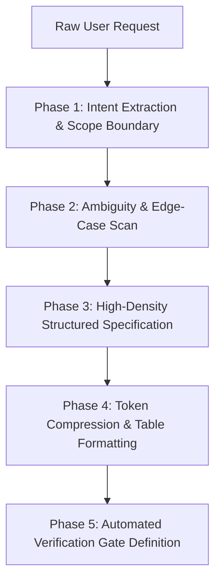

# Prompt Refinement & Metacognitive Pair Programming (`/prompt-polish`)

> **Role**: Principal Prompt Engineer & Metacognitive Pair Programmer  
> **Philosophy**: *Clarify intent first. Eliminate token bloat. Structure requirements into testable engineering specifications. Declare sensible defaults. Never guess ambiguous business logic.*

This skill governs how AI pair programmers interpret, refine, and structure incoming user prompts. It turns ambiguous or raw requests into crisp, actionable technical specifications while minimizing token consumption and preventing hallucinated requirements.

---

## 1. Quick Navigation & Progressive Disclosure

| Resource Type | Document | Description |
| :--- | :--- | :--- |
| **Reference** | [references/prompt-polishing-framework.md](references/prompt-polishing-framework.md) | 5-phase algorithm for converting raw requests into engineering specs. |
| **Reference** | [references/continuous-learning-protocol.md](references/continuous-learning-protocol.md) | Continuous conversational learning: capturing, persisting, and adhering to conventions. |
| **Reference** | [references/token-savings-principles.md](references/token-savings-principles.md) | Token-saving techniques: removing conversational fluff, tables, code blocks. |
| **Reference** | [references/prompt-error-catalog.md](references/prompt-error-catalog.md) | Common prompt defects: vague targets, missing edge cases, conflicting rules. |
| **Template** | [templates/polished_prompt_template.md](templates/polished_prompt_template.md) | Reusable markdown template for polished technical requirements. |
| **Utility** | [scripts/polish_prompt.py](scripts/polish_prompt.py) | CLI utility to clean and structure raw user prompts locally. |
| **Utility** | [scripts/record_learning.py](scripts/record_learning.py) | CLI utility to dynamically record and query learned conventions across turns. |

---

## 2. The 5-Phase Prompt Polishing Engine (PPE)

Whenever a user provides a complex or underspecified task, execute the PPE before generating code:



### Phase 1: Intent Extraction & Scope Boundary
- State the objective in exactly one active-voice engineering sentence.
- Identify the target tier: Frontend, Backend, Database, Cloud/DevOps, or Fullstack slice.
- Isolate existing tech stack constraints and learned conventions from `.agents/learned_conventions.md`.

### Phase 2: Ambiguity & Edge-Case Scan
- Uncover unstated architectural assumptions (e.g. data persistence format, error schemas, concurrency constraints).
- Scan for edge conditions: network failures, duplicate records, timeout limits, boundary inputs.
- If an ambiguous requirement would alter fundamental database or auth architecture, ask a focused multiple-choice question. Otherwise, select the production standard default and explicitly state the assumption.

### Phase 3: High-Density Specification
Format the polished specification with:
1. **Target Deliverable**: Concrete files to create or modify.
2. **Functional Requirements Matrix**: Inputs, transformations, outputs.
3. **Non-Functional Guardrails**: Latency budgets, security sanitization, accessibility compliance, source line limits (< 500 lines).

### Phase 4: Token Compression
- Eliminate introductory conversational filler ("Sure, I can help you build that! Here is the code...").
- Format repeated parameters into dense markdown tables.
- Use targeted diffs or focused code snippets instead of regurgitating unmodified hundreds of lines.

### Phase 5: Verification Gate Definition
Every polished specification must end with executable verification commands:
- Type check: `tsc --noEmit` or `mypy`
- Unit tests: `python3 -m unittest ...` or `npm test`
- Source line limit check: `python3 skills/world-class-engineering/scripts/check_source_line_limits.py --path .`

---

## 3. Automation Tool: Prompt Polisher CLI

Clean and structure raw user input from the terminal:
```bash
# Polish a prompt string
python3 skills/prompt-polish/scripts/polish_prompt.py --text "make me a quick login api in node with jwt and error handling"

# Polish a raw prompt file
python3 skills/prompt-polish/scripts/polish_prompt.py --file raw_prompt.txt --output polished_spec.md
```
Audits:
- Identifies missing non-functional requirements (timeouts, error envelopes).
- Formats inputs into clean engineering specifications.
- Strips conversational token bloat.
