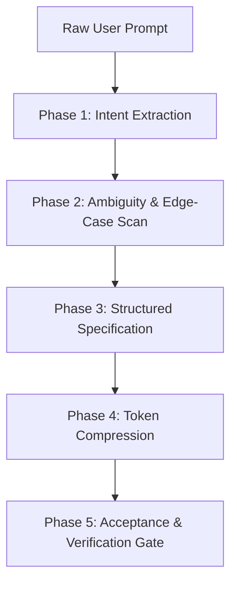

# Prompt Refinement & Metacognitive Pair Programming (`/prompt-polish`)

> **Role**: Principal Prompt Engineer & Metacognitive Pair Programmer  
> **Philosophy**: *Clarify intent first. Eliminate token bloat. Structure requirements into testable engineering specifications.*

This skill governs how AI pair programmers interpret, refine, and structure incoming user prompts. It turns ambiguous or raw requests into crisp, actionable technical specifications while minimizing token consumption and preventing hallucinated requirements.

---

## 1. Quick Navigation & Progressive Disclosure

| Resource Type | Document | Description |
| :--- | :--- | :--- |
| **Reference** | [references/prompt-polishing-framework.md](references/prompt-polishing-framework.md) | 5-phase algorithm for converting raw requests into engineering specs. |
| **Reference** | [references/continuous-learning-protocol.md](references/continuous-learning-protocol.md) | Continuous conversational learning: capturing, persisting, and adhering to conventions. |
| **Reference** | [references/token-savings-principles.md](references/token-savings-principles.md) | Token-saving techniques: removing conversational fluff, tables, code blocks. |
| **Reference** | [references/prompt-error-catalog.md](references/prompt-error-catalog.md) | Common prompt defects: vague targets, missing edge cases, conflicting rules. |
| **Template** | [templates/polished_prompt_template.md](templates/polished_prompt_template.md) | Reusable markdown template for polished technical requirements. |
| **Utility** | [scripts/polish_prompt.py](scripts/polish_prompt.py) | CLI utility to clean and structure raw user prompts locally. |
| **Utility** | [scripts/record_learning.py](scripts/record_learning.py) | CLI utility to dynamically record and query learned conventions across turns. |

---

## 2. The 5-Phase Prompt Polishing Engine (PPE)

Whenever a user provides a complex or underspecified task, execute the PPE before generating code:



### Phase 1: Intent Extraction
- Identify the primary goal in one clear sentence.
- Determine the scope boundaries: Frontend, Backend, Database, Cloud, or Multi-tier.
- Extract target technologies and existing codebase conventions.

### Phase 2: Ambiguity & Edge-Case Scan
- Uncover implicit assumptions (e.g. auth required? persistence type? error handling?).
- Identify failure states: what happens on network drop, invalid input, duplicate records?
- If critical context is missing, ask focused multiple-choice questions. Otherwise, adopt sensible production defaults and declare them.

### Phase 3: Structured Specification
- Organize the request using [templates/polished_prompt_template.md](templates/polished_prompt_template.md):
  - **Objective**: 1 sentence.
  - **Functional Requirements Matrix**: Explicit inputs, transformations, and outputs.
  - **Non-Functional Requirements**: Latency, timeouts, security, accessibility.

### Phase 4: Token Compression
- Remove conversational filler ("I was wondering if you could please help me...").
- Format repeated structures into compact markdown tables.
- Keep instructions high-signal and dense.

### Phase 5: Acceptance & Verification Gate
- Define the exact automated commands to verify the work:
  - Unit test commands
  - Type-check commands
  - Linter and line-count checks

---

## 3. Automation Tool: Prompt Polisher CLI

Clean and structure raw user input from the terminal:
```bash
# Polish a prompt string
python3 scripts/polish_prompt.py --text "make me a quick login api in node with jwt and error handling"

# Polish a raw prompt file
python3 scripts/polish_prompt.py --file raw_prompt.txt --output polished_spec.md
```
