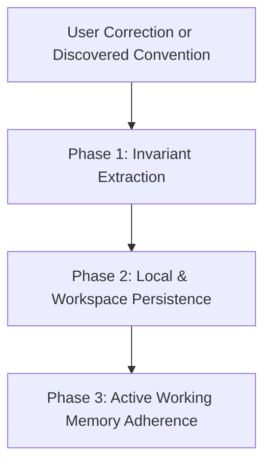

# The Continuous Learning Protocol (CLP)

Guidelines for dynamically capturing, persisting, and adhering to user preferences, corrections, and project conventions across conversation turns and sessions.

---

## 1. The 3-Phase Continuous Learning Cycle



### Phase 1: Invariant Extraction
Whenever the user issues a correction or clarifies a preference:
- Example: *"Do not use default exports in this project; use named exports."*
- Example: *"We format database columns using snake_case, not camelCase."*
- Example: *"Use Lucide SVG icons instead of emojis for buttons."*

The agent immediately extracts:
1. **Rule Category**: `[STYLE | ARCHITECTURE | DATABASE | TESTING | UI]`
2. **Invariant Rule**: The unambiguous directive to follow.
3. **Rationale**: Why the user established this constraint.

---

## 2. Phase 2: Local & Workspace Persistence

Learned conventions are persisted in `.agents/learned_conventions.md` at the project root. This ensures:
- Future turns within the same conversation read and respect the rule.
- Other team members and future Antigravity sessions automatically inherit the rule.

Schema in `.agents/learned_conventions.md`:
```markdown
# Project Learned Conventions & User Preferences

- **[ARCH-001] (2026-10-20)**: Use named exports for all React components. Default exports are prohibited to ensure consistent refactoring and symbol searching.
- **[UI-001] (2026-10-20)**: Never use raw emojis in UI buttons or headers. Use Lucide SVG icons with aria-hidden="true".
```

---

## 3. Phase 3: Active Working Memory Adherence

Before planning or executing any task:
1. **Pre-Flight Convention Scan**: Read `.agents/learned_conventions.md`.
2. **Conflict Resolution**: If a general guideline conflicts with a recorded user convention in `learned_conventions.md`, the **learned convention always wins**.
3. **Integration with `/learn`**: If the user uses the `/learn` slash command, invoke `scripts/record_learning.py` to persist the rule immediately.
