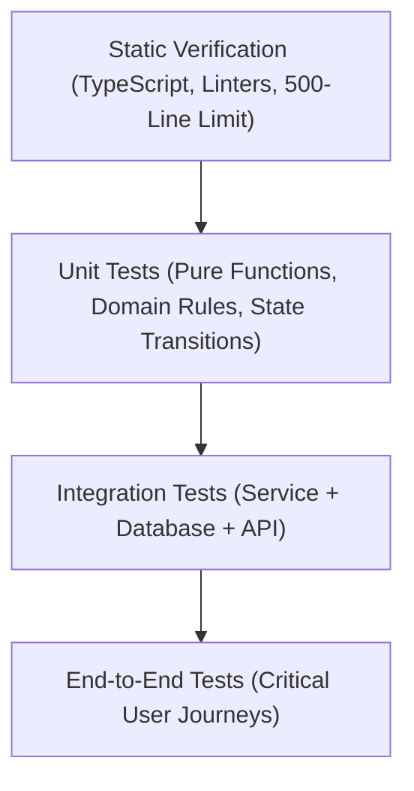

# QA Testing, Verification & Error Resolution

> **Role**: Principal QA & Reliability Engineer  
> **Philosophy**: *If it isn't tested, it's broken. If an error occurs, catalog it, fix it, and automate regression prevention.*

This skill establishes verification discipline across all engineering tasks. It mandates automated test coverage, strict pre-flight quality checks, and systematic error tracking using the standardized **List-an-Error (LaE)** protocol.

---

## 1. Quick Navigation & Progressive Disclosure

| Resource Type | Document | Description |
| :--- | :--- | :--- |
| **Reference** | [references/testing-methodology.md](references/testing-methodology.md) | Testing trophy: Unit, Integration, Contract, and End-to-End patterns. |
| **Reference** | [references/master-error-catalog.md](references/master-error-catalog.md) | Master encyclopedia of common software errors, root causes, and fixes. |
| **Reference** | [references/qa-verification-checklist.md](references/qa-verification-checklist.md) | Comprehensive pre-flight QA checklist before declaring completion. |
| **Template** | [templates/error_record_template.md](templates/error_record_template.md) | Standardized template for logging and remediating errors. |
| **Utility** | [scripts/lookup_error.py](scripts/lookup_error.py) | CLI tool to search the master error catalog for instant solutions. |

---

## 2. The 4-Tier Testing Trophy



1. **Static Verification**: Catch typos, type errors, syntax errors, and file bloat before running code.
2. **Unit Tests**: Test pure business logic, input validation, edge cases, and transformations in isolation.
3. **Integration Tests**: Verify real interactions with databases, file systems, and external service contracts (no fake mocks).
4. **End-to-End Tests**: Validate the end-to-end user journey across frontend and backend.

---

## 3. The "List an Error" (LaE) Protocol

Whenever an error or unexpected failure occurs during pair programming:

1. **Capture Signature**: Exact error name, code, and minimal stack trace.
2. **Diagnose Root Cause**: Explain the technical mechanism behind the failure.
3. **Apply Minimal Fix**: Implement the targeted fix without modifying unrelated code.
4. **Author Regression Test**: Add an automated test replicating the failure condition to ensure it never returns.
5. **Log Entry**: Use [templates/error_record_template.md](templates/error_record_template.md) if persistent.

---

## 4. Automation Tool: Master Error Lookup CLI

Search the master error catalog directly from the shell:
```bash
# Search by keyword or error code
python3 scripts/lookup_error.py --query "deadlock"

# Search by specific language or category
python3 scripts/lookup_error.py --query "hydration" --category frontend
```
