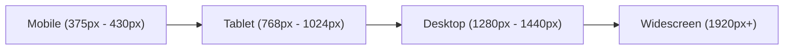
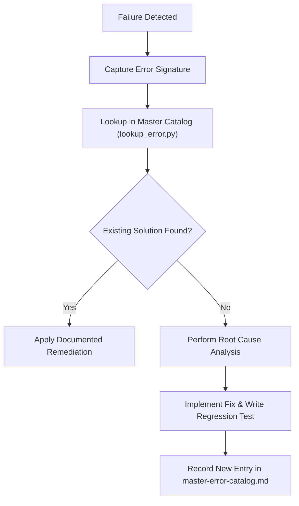
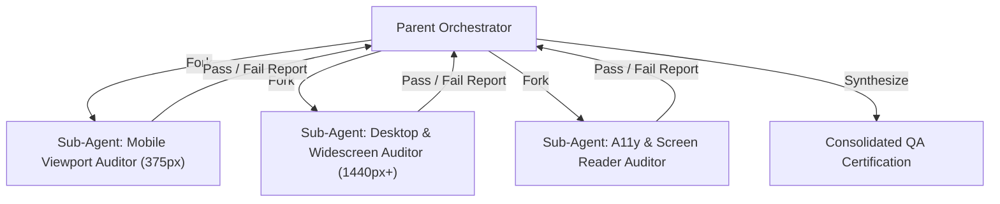

# Responsiveness, Multi-Factor QA & Sub-Agent Verification (`/qa`)

> **Philosophy**: *If it breaks at 375px or 1920px, it is broken. Software must adapt gracefully across viewports, accessibility thresholds, and sub-agent quality gates.*

This skill establishes multi-device responsiveness standards, accessibility (WCAG 2.2 AA) compliance, List-an-Error (LaE) cataloging, and automated sub-agent QA orchestration.

---

## 1. Viewport Matrix & Breakpoints

Every UI interface must be verified against the **4-Tier Viewport Matrix**:



| Device Class | Viewport (WxH) | Target Constraints & Testing Focus |
| :--- | :--- | :--- |
| **Mobile** | `375 x 667` (SE) / `390 x 844` (Modern) | Single-column, touch targets >= 44x44px, zero horizontal overflow (`overflow-x`). Drawer/bottom-sheet navigation. |
| **Tablet** | `768 x 1024` (Portrait) / `1024 x 768` | 2-column adaptive grids, collapsible sidebars, adapted font scales (`clamp()`). |
| **Desktop** | `1280 x 800` / `1440 x 900` | Full navigation, multi-pane layouts, bounded content widths (`max-w-7xl mx-auto`). |
| **Widescreen** | `1920 x 1080+` | Centered layout container, bounded gutters, no awkward stretching or isolated floating controls. |

---

## 2. Responsiveness Anti-Patterns vs. Production Standards

| Anti-Pattern | Violation | Mandatory Production Standard |
| :--- | :--- | :--- |
| **Fixed Container Widths** | `w-[800px]`, `width: 960px` | Fluid layout: `w-full max-w-5xl mx-auto`. |
| **Tiny Touch Targets** | Button padding `p-1` or `h-6 w-6` | Minimum 44x44px clickable target (`min-h-[44px] min-w-[44px]`). |
| **Missing Viewport Tag** | HTML without viewport meta | `<meta name="viewport" content="width=device-width, initial-scale=1.0">`. |
| **Unbounded Text Sizing** | Static `text-4xl` wrapping awkwardly | Fluid typography: `text-2xl sm:text-3xl md:text-4xl` or CSS `clamp()`. |
| **Missing Focus Visibility** | `outline-none` on buttons | Explicit focus rings: `focus-visible:ring-2 focus-visible:ring-offset-2`. |
| **Horizontal Scrolling** | Content wider than screen | Strict containment: `overflow-x-hidden` on wrappers, fluid widths on tables. |

---

## 3. List-an-Error (LaE) Cataloging Workflow

Whenever an automated test, build check, or runtime execution fails, log the error systematically into the master error catalog before remediating:



### Lookup CLI:
```bash
python3 skills/qa/scripts/lookup_error.py --signature "ERR_LAYOUT_OVERFLOW"
```

### Schema for Catalog Entries:
1. **Error Signature**: Canonical error identifier or string regex.
2. **Context**: Operating system, runtime version, browser/viewport.
3. **Root Cause**: Architectural or mechanical explanation.
4. **Remediation**: Exact patch diff or command to execute.
5. **Regression Test**: Test file ensuring this failure cannot recur.

---

## 4. Sub-Agent QA Orchestration Protocol

When executing comprehensive regression passes, delegate verification across parallel sub-agents:



### Sub-Agent Checklist:
- **Mobile Auditor**: Check 375px viewport with Chrome DevTools or Playwright. Verify touch targets (`min-h-[44px]`), modal sheet gestures, and no horizontal scroll.
- **Desktop Auditor**: Check 1280px and 1920px. Verify hover states, keyboard shortcuts, multi-column density, and header alignment.
- **A11y Auditor**: Check ARIA attributes (`aria-label`, `aria-expanded`, `aria-hidden`), heading hierarchy (`h1` -> `h2` -> `h3`), and color contrast ratios (>= 4.5:1).

---

## 5. Verification Tools

Audit markup and stylesheets for responsiveness violations:
```bash
python3 skills/qa/scripts/verify_responsiveness_and_qa.py --path .
```
Verify known issues against the catalog:
```bash
python3 skills/qa/scripts/lookup_error.py --list
```
