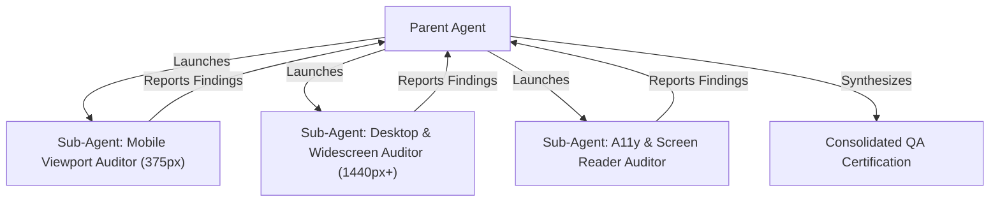

# Responsiveness, Multi-Factor QA & Sub-Agent Verification (`/qa`)

> **Philosophy**: *If it breaks at 375px or 1920px, it is broken. Software must adapt gracefully across viewports, accessibility thresholds, and sub-agent quality gates.*

This skill establishes multi-device responsiveness standards, accessibility (WCAG 2.1 AA) compliance, and automated sub-agent QA orchestration.

---

## 1. Viewport Matrix & Breakpoints

Every UI interface must be verified against the **4-Tier Viewport Matrix**:

| Device Class | Viewport (WxH) | Target Constraints & Testing Focus |
| :--- | :--- | :--- |
| **Mobile** | `375 x 667` (SE) / `390 x 844` (Modern) | Single-column, touch targets >= 44x44px, zero horizontal overflow (`overflow-x`). |
| **Tablet** | `768 x 1024` (Portrait) / `1024 x 768` | 2-column grids, collapsible sidebars, adapted font scales. |
| **Desktop** | `1280 x 800` / `1440 x 900` | Full navigation, multi-pane layouts, bounded content widths (`max-w-7xl`). |
| **Widescreen** | `1920 x 1080+` | Centered layout container, no awkward stretching or isolated floating controls. |

---

## 2. Responsiveness Anti-Patterns vs. Production Standards

| Anti-Pattern | Violation | Mandatory Production Standard |
| :--- | :--- | :--- |
| **Fixed Container Widths** | `w-[800px]`, `width: 960px` | Fluid layout: `w-full max-w-5xl mx-auto`. |
| **Tiny Touch Targets** | Button padding `p-1` or `h-6 w-6` | Minimum 44x44px clickable target (`min-h-[44px] min-w-[44px]`). |
| **Missing Viewport Tag** | HTML without viewport meta | `<meta name="viewport" content="width=device-width, initial-scale=1.0">`. |
| **Unbounded Text Sizing** | Static `text-4xl` wrapping awkwardly | Fluid typography: `text-2xl sm:text-3xl md:text-4xl` or CSS `clamp()`. |
| **Missing Focus Visibility** | `outline-none` on buttons | Explicit focus rings: `focus-visible:ring-2 focus-visible:ring-offset-2`. |

---

## 3. Sub-Agent QA Orchestration Protocol

When running complex QA, delegate specialized verification to autonomous sub-agents:



### Sub-Agent Assignment Checklist
1. **Layout Auditor**: Inspect elements for clipping, text overflow (`truncate` or `break-words`), and horizontal scrolling.
2. **Interactive State Auditor**: Check hover, active, focus-visible, and disabled states.
3. **Network Resilience Auditor**: Test with simulated slow 3G network and verify loading skeletons or spinners.
4. **Error Boundary Auditor**: Verify that failing component boundaries display actionable fallback UI without crashing the whole application.

---

## 4. Responsiveness Auditor CLI

Scan your templates and stylesheets for responsive layout violations:
```bash
python3 skills/qa/scripts/verify_responsiveness_and_qa.py --path .
```
