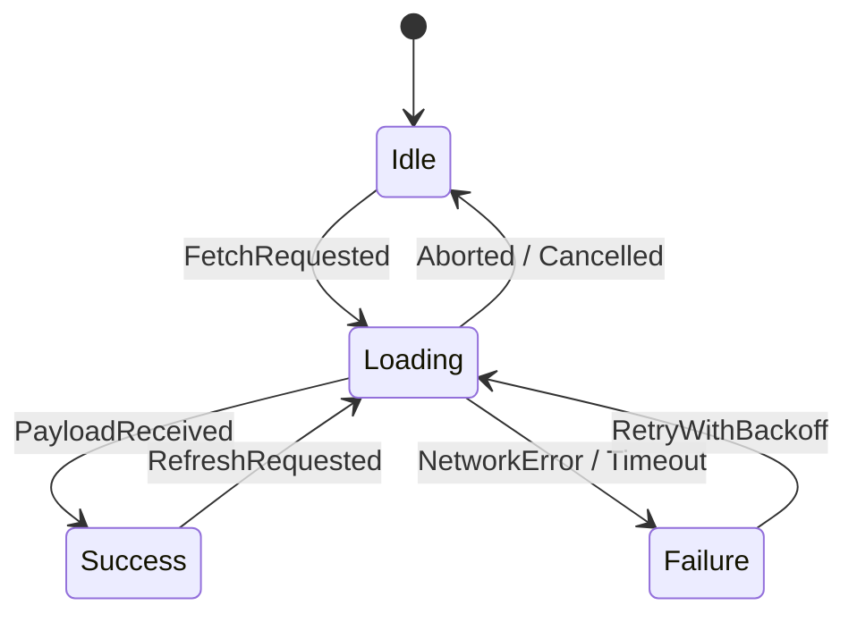
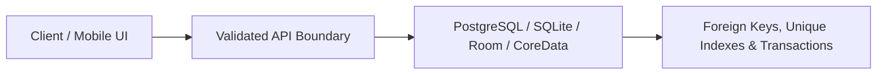
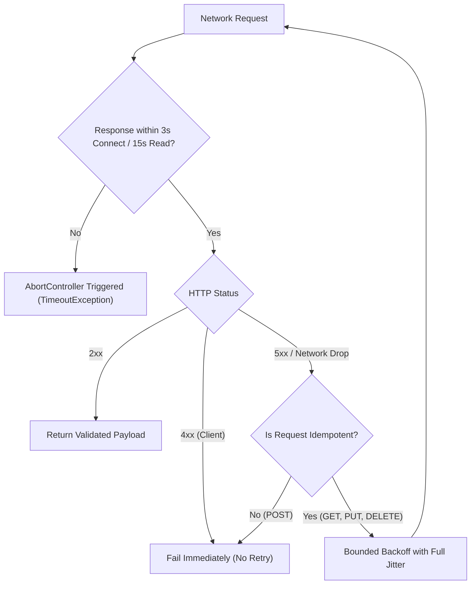
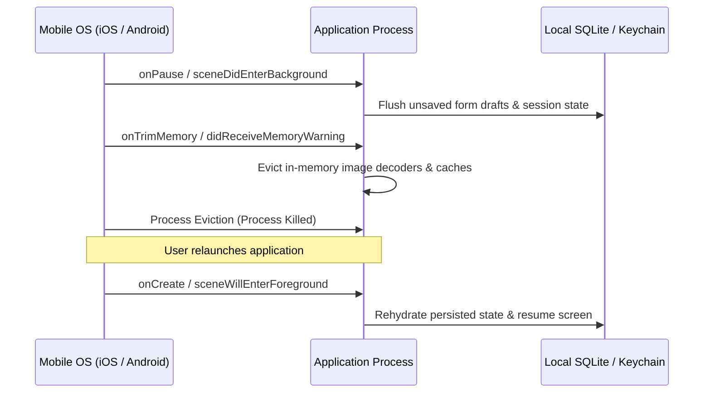
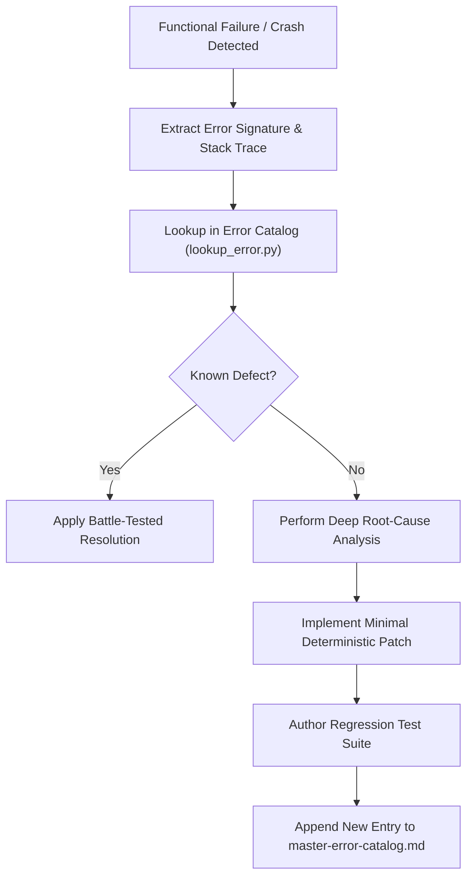

# Full App Functionality Quality Assurance Manual

> **Scope**: Runtime correctness, state determinism, anti-mock persistence, network resilience, mobile OS lifecycles, memory leak defense, security hardening, and error cataloging across Web and Mobile applications.

---

## 1. Functional Quality Contract & Core Invariants

An application is functionally broken if it crashes under backgrounding, hangs indefinitely on network failure, relies on fake mock data, or leaks memory over time. Every production feature must satisfy five functional invariants:
1. **Deterministic State Transitions**: State is modeled as explicit finite state machines (FSMs) with compile-time exhaustiveness checking; race conditions are aborted.
2. **Real Persistence**: Zero static mock arrays simulating state; all mutations persist to real schemas with foreign key integrity and transactional safety.
3. **Bounded Network Resilience**: Every network request enforces explicit $3\text{s}$ connection and $15\text{s}$ execution timeouts, debouncing ($300\text{ms}$), and jittered exponential retry on idempotent calls.
4. **Mobile Lifecycle Immunity**: The app survives backgrounding, OS-driven memory eviction (`onTrimMemory` / `didReceiveMemoryWarning`), and cold-start deep-link hydration without data loss.
5. **Zero Resource Leaks**: Every listener, timer, subscription, and coroutine is explicitly torn down when its lifecycle scope terminates.

---

## 2. Deterministic State Machines & Race Condition Defense

Unbounded state variables (`isLoading`, `isError`, `isSuccess`, `data`) invite illegal states (e.g. `isLoading && isError`). Model state as mutually exclusive states:



### Exhaustive State Handling Recipe:
- **TypeScript**: Enforce `never` exhaustiveness on discriminated unions:
  ```ts
  type AsyncState<T> =
    | { status: 'idle' }
    | { status: 'loading' }
    | { status: 'success'; data: T }
    | { status: 'failure'; error: Error };

  function assertNever(x: never): never {
    throw new Error(`Unhandled state variant: ${JSON.stringify(x)}`);
  }
  ```
- **Kotlin / Swift**: Use sealed interfaces / enums without `else` / `default` so compiler flags unhandled branches.

### In-Flight Request Cancellation & Race Condition Prevention:
When users switch tabs or search queries rapidly, stale asynchronous responses must never overwrite newer responses:
- **Web**: Use `AbortController` linked to cleanup effect.
- **Mobile**: Cancel previous `Job` (Kotlin Coroutines) or `Task` (Swift Concurrency).
- **Optimistic Updates**: Always snapshot previous state before optimistic mutation; rollback automatically if mutation fails.

---

## 3. Real Persistence & Anti-Mock Mandate

Simulating database tables with client-side in-memory collections (such as mock entity lists) is strictly prohibited. Production functionality requires real persistence:



### Persistence QA Verification Rules:
- [ ] **Schema Migrations**: Schema changes must use forward-compatible migrations (expand/contract pattern).
- [ ] **Data Integrity**: Foreign key constraints with explicit cascade policies (`ON DELETE CASCADE` or `RESTRICT`).
- [ ] **Transaction Atomicity**: Multi-step business logic (e.g. transfer balance, order checkout) must wrap in ACID transactions.
- [ ] **Offline Storage Validation**: When using local databases (SQLite, Room, CoreData, Isar), verify migration step from $v_N$ to $v_{N+1}$ without data loss.

---

## 4. Network Resilience & Fault Tolerance

Network connections are inherently unreliable. Software must be resilient by default:



### Resilience Standards:
1. **Explicit Timeouts**: Every fetch/HTTP call must specify timeout deadlines:
   - Connection timeout: $3\text{ seconds}$.
   - Read/Execution timeout: $15\text{ seconds}$.
2. **Exponential Backoff with Full Jitter**:
   $$t_{\text{sleep}} = \min(t_{\text{max}},\, t_{\text{base}} \times 2^{\text{attempt}}) \times \text{random}(0.5, 1.5)$$
3. **Idempotent Mutations**: All state-modifying requests must include `Idempotency-Key: <UUIDv4>` header to protect against double execution on retry.
4. **Input Debouncing**: Search boxes and filter controls must debounce keystrokes by $300\text{ms}$ before firing queries.

---

## 5. Mobile Platform Lifecycle & OS Resilience

Mobile operating systems aggressively reclaim resources. Apps must maintain data integrity under aggressive lifecycle transitions:



### Mobile Lifecycle Checklist:
- [ ] **Background State Preservation**: Form input, scroll offsets, and active draft records are flushed to local persistence on backgrounding.
- [ ] **Memory Trim Handlers**: Register listener for `onTrimMemory` (Android) or `didReceiveMemoryWarning` (iOS) to purge image caches and non-essential singletons.
- [ ] **Process Re-creation Test**: Enable Android Developer Option *"Don't keep activities"* and verify app state rehydrates cleanly after home-button press.
- [ ] **Deep-Link Cold Start**: Deep links (`myapp://order/123` or universal links) must resolve correctly both when app is running and when launched from a cold termination state.
- [ ] **Push Notification Payloads**: Verify incoming payload routing when app is in foreground, background, or closed.

---

## 6. Security Hardening & Vulnerability Defense

Functional security prevents privilege escalation, data exfiltration, and process crashes:

| Vulnerability | Attack Vector | Mandatory QA Defense |
| :--- | :--- | :--- |
| **Credential Leakage** | Hardcoded API keys or secrets in source code | Scan codebase with security tools; inject via environment variables (`process.env`). |
| **SQL Injection** | Unsanitized string concatenation in queries | 100% parameterized queries or typed ORM builders (Prisma, Drizzle, Room). |
| **Command Injection** | Raw command execution via `exec` | Never pass raw user inputs to shell execution; use argument arrays (`execFile`, `ProcessBuilder`). |
| **Boundary Tampering** | Malformed incoming JSON payloads | Strict schema validation at system boundaries (Zod, Pydantic, Serde). |
| **Sensitive Storage** | Storing session tokens in plain text | Store tokens in OS Keychain (iOS) / EncryptedSharedPreferences (Android) / HTTP-only Secure cookies (Web). |

---

## 7. Resource Leaks & Memory Management

Memory and handle leaks cause application degradation and sudden termination:

### Common Leak Vectors & Remediations:
1. **Uncleaned Event Listeners**:
   - Every `addEventListener` must have a matching `removeEventListener` in the cleanup phase.
2. **Orphan Timers**:
   - Always clear `setInterval` and `setTimeout` references inside `useEffect` or lifecycle teardown.
3. **Dangling Asynchronous Tasks**:
   - In Flutter, invoke `StreamSubscription.cancel()` inside `dispose()`.
   - In Kotlin, launch background work in `viewModelScope` or `lifecycleScope`.
   - In Swift, manage tasks using `@StateObject` and structured concurrency task groups.
4. **Detached DOM Nodes**:
   - Profile memory usage with heap snapshots; ensure unmounted components release references to parent DOM nodes.

---

## 8. Master Error Cataloging Workflow (List-an-Error)

Whenever a functional defect, runtime crash, or edge-case failure occurs during QA, it must be systematically documented in the master error catalog (`master-error-catalog.md`):



### Required Fields for New Catalog Entries:
- **Error ID**: Standard prefix `[ERR-FE-xxx]`, `[ERR-BE-xxx]`, `[ERR-MOB-xxx]`, `[ERR-SEC-xxx]`.
- **Category**: Frontend, Backend, Database, Mobile, Cloud, Security.
- **Symptom**: Verbatim error message or observable misbehavior.
- **Root Cause**: Architectural and mechanical defect description.
- **Diagnostic Command**: Command or inspection technique to isolate defect.
- **Resolution**: Step-by-step remediation instructions.
- **Regression Prevention**: Automated test confirming permanent resolution.

---

## 9. Full App Functionality QA Checklist

Before certifying any application feature, verify:
- [ ] **State Machine Check**: All states (`idle`, `loading`, `success`, `failure`) handled exhaustively.
- [ ] **Anti-Mock Check**: All data backed by real database schemas and validated API endpoints.
- [ ] **Timeout Check**: Explicit $3\text{s}$ connection and $15\text{s}$ read timeouts configured on all network clients.
- [ ] **Retry Check**: Jittered exponential backoff active on idempotent failures; zero retries on 4xx.
- [ ] **Debounce Check**: High-frequency inputs debounced by $300\text{ms}$.
- [ ] **Lifecycle Check**: Form inputs and session state survive app backgrounding and process kill.
- [ ] **Deep-Link Check**: Cold-start deep link parses parameters and routes to destination screen.
- [ ] **Security Check**: Zero hardcoded secrets, 100% parameterized queries, strict boundary validation.
- [ ] **Cleanup Check**: Event listeners, timers, subscriptions, and coroutines properly cancelled on unmount.
- [ ] **Catalog Check**: Any encountered bug documented in `master-error-catalog.md` with regression test.
