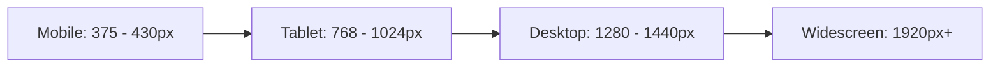
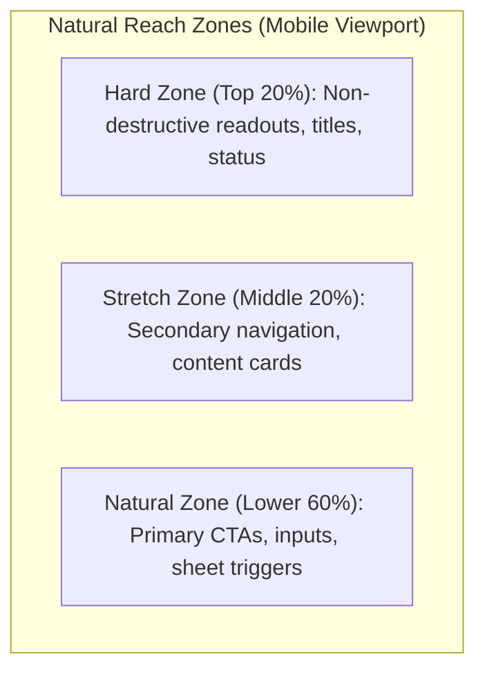
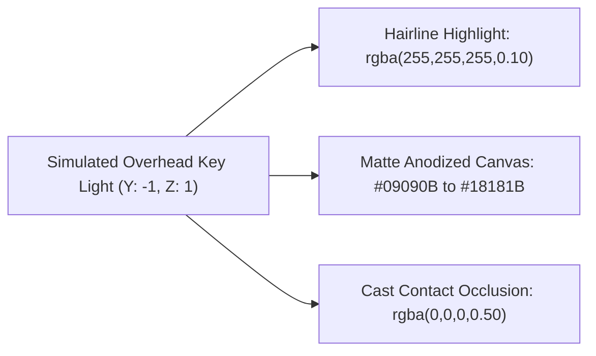

# Full UI & Frontend Quality Assurance Manual

> **Scope**: Visual precision, ergonomic reachability, accessibility compliance, sub-pixel lighting physics, typography stability, and 120Hz GPU rendering across Web (React, Next.js, Vue, Svelte) and Mobile (React Native, iOS SwiftUI, Android Jetpack Compose, Flutter).

---

## 1. Quality Contract & Core Invariants

A user interface is not production-ready until it satisfies four fundamental invariants:
1. **Viewport Invariance**: Zero horizontal overflow, zero clipped cards, and zero awkward line breaks from 375px up to 1920px+.
2. **Physical Ergonomics**: Every interactive touch target measures at least 44x44pt (iOS) / 48x48dp (Android) with thumb-zone alignment.
3. **Sensory Restraint**: Specular lighting uses directional hairlines and physical falloff; zero AI-slop neon purple glows or card soup.
4. **Compositor Efficiency**: Animations run strictly on the GPU (120Hz ProMotion/High-Refresh compliant) with underdamped oscillation prevented ($\zeta \approx 0.75-0.90$).

---

## 2. 4-Tier Viewport & Safe-Area Matrix

Every layout must be systematically verified across all four viewport tiers and native system safe areas:



| Device Class | Viewport Range | Key Constraints & Testing Focus |
| :--- | :--- | :--- |
| **Mobile Compact** | `375x667` (SE) to `390x844` (iPhone) | Single-column stack, bottom-docked action bars, drawer navigation, zero horizontal scrolling. |
| **Mobile Pro / Fold** | `430x932` (Pro Max) / Foldables | Dynamic Island & notch clearance, safe-area insets, folding hinge boundary detection. |
| **Tablet** | `768x1024` (Port) / `1024x768` (Land) | 2-column adaptive grid, persistent or collapsible sidebars, iPad Stage Manager resizing. |
| **Desktop** | `1280x800` to `1440x900` | Multi-pane density, bounded content gutters (`max-w-7xl mx-auto`), hover states, tooltips. |
| **Widescreen** | `1920x1080` to `2560x1440+` | Centered layout container, bounded gutters, zero isolated floating controls at far edges. |

### Safe-Area Engineering Rules:
- **Web**: Enforce `viewport-fit=cover` and use `env(safe-area-inset-top)` / `env(safe-area-inset-bottom)`.
- **React Native**: Wrap root screens in `SafeAreaView` from `react-native-safe-area-context` with `edges={['top', 'bottom']}`.
- **SwiftUI**: Use `.ignoresSafeArea()` selectively on background layers only; never on interactive controls.
- **Jetpack Compose**: Use `Modifier.windowInsetsPadding(WindowInsets.safeDrawing)`.
- **Flutter**: Wrap interactive trees in `SafeArea(top: true, bottom: true)`.

---

## 3. Touch Ergonomics & Reachability Zones

Human hand anatomy dictates interface usability. Interactive controls must conform to thumb-zone ergonomics:



### Hit-Target Dimension Checklist:
- [ ] **Apple HIG Minimum**: $44 \times 44\text{ pt}$ hit area for all buttons, icons, links, and segmented controls.
- [ ] **Material Design Minimum**: $48 \times 48\text{ dp}$ hit area with minimum $8\text{ dp}$ spatial clearance between targets.
- [ ] **Visual vs. Hit Target Decoupling**: If visual icon is $16\text{ px}$ or $20\text{ px}$, expand touch hit slop via padding or hit rects (`hitSlop={{ top: 12, bottom: 12, left: 12, right: 12 }}`).
- [ ] **Destructive Action Safety**: Never place destructive triggers (e.g., "Delete Account", "Purge Database") in the instant thumb-strike zone without explicit two-step confirmation.

---

## 4. Accessibility & Contrast Engineering (WCAG 2.2 AA)

Accessible design is an engineering discipline, not an afterthought:

| Element Type | Minimum Contrast Ratio | Implementation Guideline |
| :--- | :--- | :--- |
| **Body Text (< 18pt)** | `4.5:1` | Dark mode: `#FAFAFA` on `#09090B` (`19.5:1`). Light mode: `#09090B` on `#FFFFFF`. |
| **Large Text (>= 18pt or >= 14pt bold)** | `3.0:1` | Use muted secondary tones only when contrast exceeds `3.0:1` (`#A1A1AA` on `#09090B` = `7.8:1`). |
| **Interactive Borders & Controls** | `3.0:1` | Hairline borders on inputs and buttons must remain distinct from canvas background. |
| **Focus Indicators** | `3.0:1` against adjacent colors | Minimum $2\text{ px}$ ring thickness with $2\text{ px}$ offset (`ring-2 ring-zinc-400 ring-offset-2`). |

### Multi-Platform Semantics Matrix:
- **Web**: Strict ARIA tagging (`aria-label`, `aria-expanded`, `aria-hidden="true"` on decorative icons, `role="dialog"`).
- **React Native**: `accessible={true}`, `accessibilityLabel="Search"`, `accessibilityRole="button"`, `accessibilityState={{ expanded: isOpen }}`.
- **SwiftUI**: `.accessibilityLabel("Search commands")`, `.accessibilityAddTraits(.isButton)`, `.accessibilityValue(percentage)`.
- **Jetpack Compose**: `Modifier.semantics { contentDescription = "Search commands"; role = Role.Button }`.
- **Flutter**: `Semantics(button: true, label: "Search commands", child: ...)`.

### Dynamic Type & Text Scaling (200% Test):
- Verify layouts scale under iOS Accessibility Large (`UIContentSizeCategoryAccessibilityExtraExtraExtraLarge`) and Android $200\%$ Font Scale.
- Disallow fixed container heights (`h-12`, `height: 48px`) on containers wrapping multi-line text; use `min-h-[48px]` and fluid vertical expansion.

---

## 5. Sub-Pixel Directional Lighting & Tactile Materials

Craftsmanship relies on physically credible light reflection rather than synthetic diffuse glows:



### Material Construction Rules:
- **Hairline Top Highlight**: `border-t border-white/[0.08]` or `inset 0 1px 0 rgba(255, 255, 255, 0.08)`.
- **Sub-Pixel Specular Catch**: Add a $1\text{ px}$ radial or linear sheen across interactive headers to ground tactile affordance.
- **Contact Shadow Occlusion**: Shadows must have physical decay ($2\text{ px}$ offset, $4\text{ px}$ blur, $0.4$ alpha), never floating $40\text{ px}$ neon halos.
- **Anti-AI-Slop Prohibition**: Zero purple-to-indigo rainbow borders, zero glowing gradients, zero raw emojis inside buttons.

---

## 6. Typography & Layout Stability (Zero Jiggle & CLS < 0.05)

### Tabular Numbers Requirement:
Every dynamic numeric value (countdown timers, financial amounts, system metrics, coordinates) must enforce tabular figures to prevent horizontal jiggle during updates:
- **CSS / Tailwind**: `font-variant-numeric: tabular-nums` or `tabular-nums`.
- **OpenType Features**: `font-feature-settings: "tnum" 1, "zero" 1`.
- **React Native / iOS**: `fontVariant: ['tabular-nums']`.
- **SwiftUI**: `.monospacedDigit()`.
- **Compose**: `FontFeature("tnum")`.
- **Flutter**: `fontFeatures: [FontFeature.tabularFigures()]`.

### Layout Shift Prevention:
- Explicit `aspect-ratio` on all media containers (`aspect-video`, `aspect-square`).
- Always reserve exact vertical dimensions for asynchronous data using skeleton loaders matching the target layout geometry.
- Horizontal overflow is strictly prohibited: Audit with `document.querySelectorAll('*').forEach(el => el.scrollWidth > document.documentElement.clientWidth && console.warn(el))`.

---

## 7. 120Hz GPU Compositor & Motion QA

### Compositor Constraints:
- **Web**: Only animate `transform` and `opacity`. Never animate `top`, `left`, `width`, `height`, or `margin`.
- **Mobile**: Always bind animations to the native compositor thread:
  - React Native: `useNativeDriver: true` with Animated API or React Native Reanimated worklets (`runOnUI`).
  - SwiftUI: Use declarative `.animation(.spring(...), value: ...)` running on Core Animation.
  - Jetpack Compose: Use `animateFloatAsState` with `graphicsLayer { translationX = ... }`.
  - Flutter: Build transitions inside `AnimatedBuilder` or custom painters avoiding widget rebuilds.

### Spring Physics Standards:
Avoid chaotic, bouncy cartoon animations. Enforce disciplined mechanical damping:
$$\zeta = \frac{c}{2\sqrt{mk}} \approx 0.75 - 0.90$$
- Mass ($m$): $1.0$
- Stiffness ($k$): $180 - 300\text{ N/m}$
- Damping ($c$): $24 - 32\text{ Ns/m}$ (sub-critical damping with maximum 1 subtle overshoot).

---

## 8. Framework-Native UI Verification Recipes

### Web (React / Tailwind):
```tsx
// Clean, accessible, tabular, hairline-lit control
export function TelemetryPill({ label, value }: { label: string; value: number }) {
  return (
    <div className="inline-flex items-center gap-2 px-3 py-1.5 rounded-md bg-zinc-900 border border-white/[0.08] shadow-sm">
      <span className="text-xs font-medium text-zinc-400">{label}</span>
      <span className="text-sm font-semibold text-zinc-100 tabular-nums">
        {value.toFixed(2)}
      </span>
    </div>
  );
}
```

### React Native:
```tsx
import React from 'react';
import { Pressable, Text, StyleSheet } from 'react-native';

export function TactileButton({ title, onPress }: { title: string; onPress: () => void }) {
  return (
    <Pressable
      onPress={onPress}
      accessibilityRole="button"
      accessibilityLabel={title}
      hitSlop={{ top: 8, bottom: 8, left: 8, right: 8 }}
      style={({ pressed }) => [styles.btn, pressed && styles.pressed]}
    >
      <Text style={styles.text}>{title}</Text>
    </Pressable>
  );
}

const styles = StyleSheet.create({
  btn: {
    minHeight: 44,
    minWidth: 44,
    justifyContent: 'center',
    alignItems: 'center',
    paddingHorizontal: 16,
    borderRadius: 8,
    backgroundColor: '#18181B',
    borderWidth: 1,
    borderColor: 'rgba(255, 255, 255, 0.1)',
  },
  pressed: { opacity: 0.8 },
  text: { color: '#FAFAFA', fontSize: 15, fontWeight: '600' },
});
```

---

## 9. Full UI / Frontend QA Execution Checklist

Before certifying any UI deliverable, complete this audit:
- [ ] **Viewport Check**: Tested at 375px, 768px, 1280px, and 1920px. Zero horizontal scrollbar.
- [ ] **Safe-Area Check**: Dynamic Island, notch, and home bar insets properly padded.
- [ ] **Touch Target Check**: Every interactive control >= 44x44pt hit area.
- [ ] **Contrast Check**: All text meets or exceeds WCAG 2.2 AA (4.5:1 body, 3:1 large).
- [ ] **Focus Check**: Keyboard Tab navigation displays visible, high-contrast focus rings.
- [ ] **Screen Reader Check**: Semantic roles, names, and values vocalized correctly.
- [ ] **Typography Check**: Tabular figures applied to all dynamic metrics and counters.
- [ ] **Compositor Check**: 120Hz smooth animation without layout recalculations or dropped frames.
- [ ] **Reduced Motion Check**: All transitions honor `prefers-reduced-motion` settings.
- [ ] **Anti-Slop Audit**: Zero decorative shields, zero glowing neon halos, zero raw emojis in buttons.
