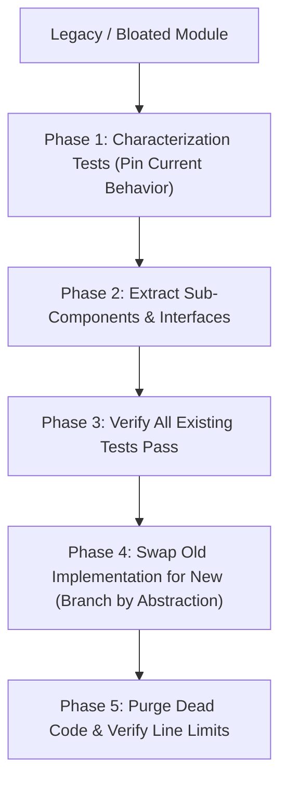

# Safe Refactoring & Technical Debt Remediation (`/refactor`)

> **Philosophy**: *Never refactor without tests. Change behavior or change structure, never both in the same turn. Decompose god files before they hit 500 lines.*

This skill establishes disciplined patterns for paying down technical debt, decomposing bloated modules, and modernizing legacy code without outages.

---

## 1. The Two-Hat Refactoring Protocol



### Rule 1: The "Two Hats" Discipline
- When wearing the **Refactoring Hat**, do not add new features or modify existing contracts. Only restructure code to improve cohesion, naming, and readability.
- When wearing the **Feature Hat**, do not perform sweeping architectural refactors. Write minimal changes to satisfy requirements.

### Rule 2: Decomposing Files Approaching 500 Lines
- Monitor file lengths proactively. If any source file reaches **350–400 lines**, decompose it immediately:
  - Extract pure helper utilities to a sibling `utils/` or `helpers/` module.
  - Extract domain entity schemas to `types.ts` or `models.py`.
  - Extract database queries to a dedicated `repository.ts`.
- Never allow a file to breach the hard **500-line source file limit**.

---

## 2. Refactor Opportunities Detector CLI

Scan your repository for complex, deeply-nested, or bloated files needing refactoring:
```bash
python3 skills/refactor/scripts/detect_refactor_opportunities.py --path .
```
