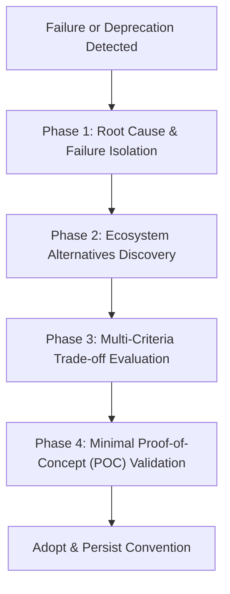

# Autonomous Deep Research & Alternatives (`/research`)

> **Philosophy**: *Never get blocked. When an approach, library, or API fails, pivot systematically to tested, production-grade alternatives.*

This skill guides agents and engineers through autonomous deep research, competitive benchmarking, compatibility validation, and zero-downtime dependency alternatives.

---

## 1. The Fallback & Alternative Decision Framework

When a package fails to install, exhibits breaking bugs, lacks critical features, or fails verification, execute the **4-Step Autonomous Pivot**:



### Phase 1: Failure Isolation
- Isolate whether the failure is environmental (missing C++ build tools, Python version mismatch) or systemic (library abandoned, archived repo, incompatible licenses).
- Document the exact error signature.

### Phase 2: Ecosystem Discovery
- Search established open-source alternatives across registries (npm, PyPI, Crates.io, Go modules).
- Benchmark against industry standards (e.g., Node.js built-in `fetch` vs `axios`, `better-sqlite3` vs `sqlite3`, `zod` vs `joi`, `date-fns` vs `moment`).

### Phase 3: Multi-Criteria Trade-off Evaluation
Evaluate each candidate alternative against the **P.A.T.H.S.** criteria:
1. **P**erformance: Execution speed, startup latency, memory footprint.
2. **A**ctivity: Recent commits, responsive maintainers, semantic release cadence.
3. **T**ype Safety: First-class TypeScript/type annotations; zero `any` leaks.
4. **H**ygiene: Permissive license (MIT, Apache-2.0, BSD-3), zero high-severity CVEs.
5. **S**ize & Dependencies: Minimal transitive dependency tree; prefer native stdlib.

### Phase 4: Minimal POC Validation
- Implement a 20-line standalone reproduction verifying the required API contract before updating production code.

---

## 2. Common Production Pivot Table

| Failing / Deprecated Pattern | Recommended Modern Alternative | Rationale |
| :--- | :--- | :--- |
| `moment.js` | `date-fns` or native `Intl` | Zero bundle bloat, immutable, tree-shakeable. |
| `request` / `axios` | Native `fetch` / `undici` | Node 18+ standard built-in, zero external dependencies. |
| `node-sass` / `libsass` | `sass-embedded` / Tailwind CSS | `libsass` is deprecated; native Dart Sass is maintained. |
| `sqlite3` (node-gyp rebuilds) | `better-sqlite3` or Drizzle ORM | Synchronous, fast, avoids native build failures. |
| `pydantic` v1 (`@validator`) | `pydantic` v2 (`@field_validator`) | 5x-10x Rust-backed performance, strict typing. |
| `enzyme` | `@testing-library/react` | Tests behavior instead of implementation details. |

---

## 3. Alternative Research CLI

Audit known dependency replacements and evaluate fallback paths:
```bash
python3 skills/research/scripts/research_alternatives.py --query <package_or_domain>
```
