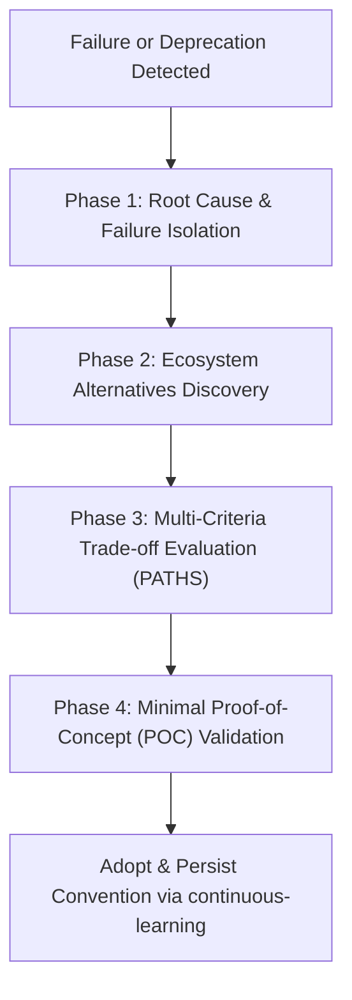

# Autonomous Deep Research & Alternatives (`/research`)

> **Philosophy**: *Never get blocked. When an approach, library, or API fails, pivot systematically to tested, production-grade alternatives.*

This skill guides agents and engineers through autonomous deep research, competitive benchmarking, compatibility validation, and zero-downtime dependency alternatives.

---

## 1. The Fallback & Alternative Decision Framework

When a package fails to install, exhibits breaking bugs, lacks critical features, or fails verification, execute the **4-Step Autonomous Pivot**:



### Phase 1: Failure Isolation & Environment Diagnosis
- Isolate whether the failure is environmental (missing native build toolchains, Python/Node version mismatch, cross-compilation errors) or architectural (abandoned library, unmaintained repository, breaking upstream API changes).
- Document the exact compiler output or stack trace.

### Phase 2: Ecosystem Discovery & Open-Source Auditing
- Query modern registries: npm, PyPI, Crates.io, Go modules.
- Check OpenSSF Scorecards, recent release cadences, and active issue triage.
- Evaluate bundle impact via tools like Bundlephobia (aim for < 30kB gzipped for frontend libraries).

### Phase 3: The P.A.T.H.S. Evaluation Matrix
Score every candidate replacement (1-5 scale) across five strict engineering criteria:

| Criterion | Key Metric | Red Flags |
| :--- | :--- | :--- |
| **P - Performance** | Benchmark throughput, memory usage, cold start latency | High GC pressure, CPU-blocking sync calls in async event loops |
| **A - Activity** | Commits within last 90 days, active maintainers, semver tags | Last commit > 1 year ago, unaddressed security issues |
| **T - Type Safety** | Native TypeScript definitions, strict type inference | Third-party `@types/*` that lag behind releases, excessive `any` |
| **H - Hygiene** | Permissive license (MIT, Apache-2.0, BSD-3), zero critical CVEs | Viral copyleft licenses (GPL-3.0 in proprietary code), unpatched CVEs |
| **S - Size & Dependencies** | Minimal transitive dependency graph; zero C++ build steps | Massive `node_modules` explosion, heavy native compilation flags |

### Phase 4: Minimal Proof-of-Concept (POC)
Before introducing any new dependency into production, author a 20-30 line standalone verification script in `scratch/`:
1. Verify essential API methods and error handling.
2. Verify TypeScript type checking and bundling.
3. Verify that native bindings execute cleanly on the host environment (macOS ARM64, Linux x86_64).

---

## 2. Common Production Pivot Table

| Failing / Deprecated Pattern | Recommended Modern Alternative | Architecture Advantage |
| :--- | :--- | :--- |
| `moment.js` | `date-fns` or native `Intl.DateTimeFormat` | Zero bundle bloat, immutable objects, tree-shakeable. |
| `request` / `axios` | Native `fetch` / `undici` | Node 18+ standard built-in, zero external dependencies. |
| `node-sass` / `libsass` | `sass-embedded` / Tailwind CSS v4 | Native Dart Sass binary protocol, active maintenance. |
| `sqlite3` (node-gyp rebuilds) | `better-sqlite3` or Drizzle ORM | Synchronous execution, 10x faster reads, avoids build failures. |
| `pydantic` v1 (`@validator`) | `pydantic` v2 (`@field_validator`) | Rust-backed core, 5x-10x throughput, strict typing. |
| `enzyme` | `@testing-library/react` | Tests accessible user behavior instead of internal component state. |
| `canvas` (native Cairo) | `@napi-rs/canvas` or SVG renderer | Prebuilt native bindings via N-API, zero system Cairo/Pango requirements. |

---

## 3. Alternative Research CLI

Audit known dependency replacements and evaluate fallback paths:
```bash
python3 skills/research/scripts/research_alternatives.py --query <package_or_domain>
```
Example:
```bash
python3 skills/research/scripts/research_alternatives.py --query sqlite
```
