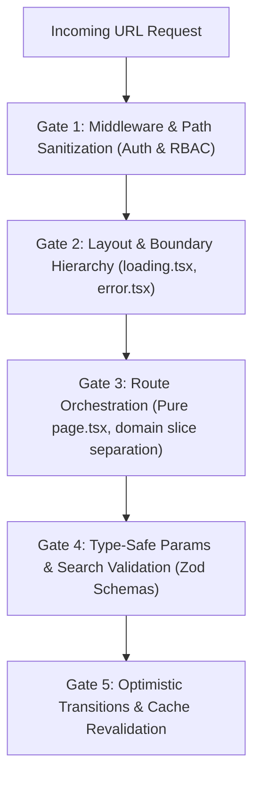

# File-Based Routing & Deep URL Layout Architecture (`/routing`)

> **Philosophy**: *URLs are the primary contract of the web. Route entrypoints (page.tsx) must remain pure orchestrators. Co-locate feature components in domain slices, never in route roots. Dynamic segments require loading and error boundaries. Layout nesting must not exceed 4 levels.*

This skill establishes defensive engineering standards for file-based and declarative routing across **Next.js App Router**, **React Router v7 / Remix**, **TanStack Router**, and **Flutter GoRouter**.

---

## 1. Quick Navigation & Progressive Disclosure

| Resource Type | Document | Description |
| :--- | :--- | :--- |
| **Reference** | [references/nextjs-app-router-patterns.md](references/nextjs-app-router-patterns.md) | File conventions (page, layout, loading, error), parallel and intercepting routes. |
| **Reference** | [references/flutter-declarative-routing.md](references/flutter-declarative-routing.md) | GoRouter declarative setups, redirect guards, deep linking on mobile/web. |
| **Utility** | [scripts/verify_routing_architecture.py](scripts/verify_routing_architecture.py) | Scans route directories for bloated page.tsx files, missing error/loading boundaries, and deep layout nesting. |

---

## 2. The Core Routing Architecture Gates



1. **Gate 1: Edge Path Sanitization**: Validate route params and authorization headers in middleware before executing server components.
2. **Gate 2: Mandatory Fallback Boundaries**: Every dynamic route segment (`[id]`, `[slug]`) must provide co-located `loading.tsx` (or skeleton) and `error.tsx` (with reset boundary).
3. **Gate 3: Pure Route Entrypoints**: `page.tsx` must only extract params, trigger domain data fetching, and render domain container components. Zero inline business logic or heavy sub-components.
4. **Gate 4: Type-Safe Param & Query Validation**: Parse and validate dynamic route parameters and query strings using **Zod** or strict type guards.
5. **Gate 5: Layout Nesting Ceiling**: Limit layout nesting to a maximum depth of **4 levels** (`/`, `/(dashboard)`, `/projects`, `/[id]`) to prevent layout thrashing and context bloating.

---

## 2. Next.js App Router Layout Hierarchy

```
app/
├── layout.tsx                # Root layout (HTML, fonts, global providers)
├── page.tsx                  # Public home page
├── (auth)/                   # Route group (isolated layout, zero URL penalty)
│   ├── layout.tsx            # Auth layout (centered card, zero sidebar)
│   ├── login/page.tsx
│   └── register/page.tsx
└── (dashboard)/              # Route group for authenticated workspace
    ├── layout.tsx            # Dashboard shell (collapsible sidebar, command bar)
    └── projects/
        ├── page.tsx          # Project index list
        └── [projectId]/      # Dynamic segment
            ├── layout.tsx    # Project tab navigation
            ├── page.tsx      # Project overview
            ├── loading.tsx   # Mandatory Suspense skeleton
            ├── error.tsx     # Mandatory client error boundary ('use client')
            └── settings/
                └── page.tsx  # Deep nested route (Depth 4)
```

---

## 3. Pure Route Orchestrator & Type-Safe Params (TypeScript)

```typescript
// app/(dashboard)/projects/[projectId]/page.tsx
import { notFound } from "next/navigation";
import { z } from "zod";
import { ProjectDetailContainer } from "@/features/projects/components/ProjectDetailContainer";
import { getProjectById } from "@/features/projects/server/projectService";

const RouteParamsSchema = z.object({
  projectId: z.string().uuid("Invalid project identifier")
});

interface PageProps {
  params: Promise<{ projectId: string }>;
}

export default async function ProjectPage({ params }: PageProps) {
  const resolvedParams = await params;
  const parsed = RouteParamsSchema.safeParse(resolvedParams);

  if (!parsed.success) {
    notFound();
  }

  const project = await getProjectById(parsed.data.projectId);
  if (!project) {
    notFound();
  }

  return <ProjectDetailContainer project={project} />;
}
```

---

## 4. Routing Architecture Verification CLI

Audit your routing tree for missing error/loading boundaries and deep layout nesting:

```bash
python3 skills/routing/scripts/verify_routing_architecture.py --path . --strict
```

Audited Rules:
- `ROUTING-MISSING-LOADING-BOUNDARY`: Flags dynamic segments (`[id]`) missing a sibling `loading.tsx` or skeleton.
- `ROUTING-MISSING-ERROR-BOUNDARY`: Flags dynamic segments missing a sibling `error.tsx` boundary.
- `ROUTING-EXCESSIVE-LAYOUT-DEPTH`: Flags route trees exceeding 4 nested layout levels.
- `ROUTING-POLLUTED-PAGE-ENTRYPOINT`: Flags `page.tsx` files exceeding 100 lines with co-located business components.
