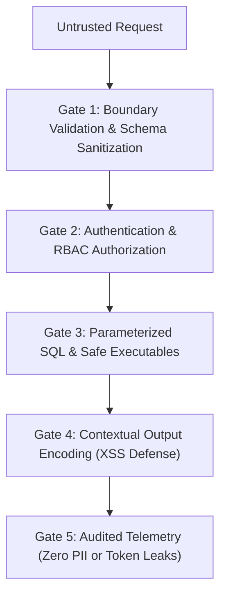

# Security Hardening & Vulnerability Defense (`/security`)

> **Philosophy**: *Assume breach. Defense in depth. Never trust client input. Never interpolate variables into queries or shell commands. Never commit credentials. Hash passwords with Argon2id.*

This skill establishes defensive security standards across web applications, APIs, databases, container environments, and secret management lifecycles.

---

## 1. The Core Security Gates



---

## 2. OWASP Top 10 Hardening Standards

### 2.1 Injection Prevention (SQL, Command, LDAP)
- **Zero SQL String Interpolation**:
  ```typescript
  // ❌ VULNERABLE: Direct SQL injection risk
  const user = await db.query(`SELECT * FROM users WHERE email = '${email}'`);

  // ✅ DEFENSIVE: Parameterized prepared statement
  const user = await db.query("SELECT * FROM users WHERE email = $1", [email]);
  ```
- **Zero Shell Interpolation**: Never pass user input to `child_process.exec()` or Python `subprocess.run(..., shell=True)`. Use array form: `subprocess.run(["git", "checkout", branch], check=True)`.

### 2.2 Broken Access Control & IDOR Defense
Never rely on client-supplied IDs without verifying ownership in the same transaction:
```sql
-- Always scope mutations to the authenticated tenant/user ID
UPDATE documents 
SET title = $1 
WHERE id = $2 AND tenant_id = $3;
```

### 2.3 Cryptographic Hygiene & Password Hashing
- **Password Storage**: Use **Argon2id** (memory cost 64MB, time cost 3 iterations) or **bcrypt** with work factor >= 12. Never use SHA-256 or MD5 for passwords.
- **Tokens**: Generate high-entropy cryptographically secure random bytes via `crypto.randomBytes(32)` or `secrets.token_urlsafe(32)`.

### 2.4 Cookie & Session Security
All authentication cookies must specify strict flags:
```
Set-Cookie: session_id=...; Secure; HttpOnly; SameSite=Lax; Path=/; Max-Age=86400
```
- `HttpOnly`: Blocks JavaScript `document.cookie` access (XSS token theft mitigation).
- `Secure`: Transmits cookies only over HTTPS.
- `SameSite=Lax` / `Strict`: Prevents Cross-Site Request Forgery (CSRF).

---

## 3. Path Traversal & File Handling

Always normalize and verify file paths to prevent directory traversal (`../../etc/passwd`):

```typescript
import path from "node:path";

export function resolveSafePath(rootDir: string, userPath: string): string {
  const safeRoot = path.resolve(rootDir);
  const targetPath = path.resolve(safeRoot, userPath);

  if (!targetPath.startsWith(safeRoot)) {
    throw new SecurityException("Directory traversal attempt detected");
  }
  return targetPath;
}
```

---

## 4. Secret Hygiene & Environment Variable Rules

1. **Never commit `.env` files**: Ensure `.gitignore` explicitly ignores `.env`, `.env.local`, `.env.*.local`, and `*.pem` keys.
2. **Provide `.env.example`**: Maintain an up-to-date `.env.example` containing dummy template keys and setup instructions.
3. **Scan with Pre-Commit Hooks**: Integrate `gitleaks` or `git-secrets` in local dev and CI pipelines.

---

## 5. Security Hygiene Auditor CLI

Scan your repository for hardcoded secrets, unsafe shell executions, and query interpolations:
```bash
python3 skills/security/scripts/audit_security_hygiene.py --path .
```
Audits:
- Unsafe `exec`, `eval`, or `shell=True` calls.
- SQL queries constructed with string concatenation or f-strings.
- Exposed API keys, private keys, or passwords.
- Cookie headers missing `Secure`, `HttpOnly`, or `SameSite`.
