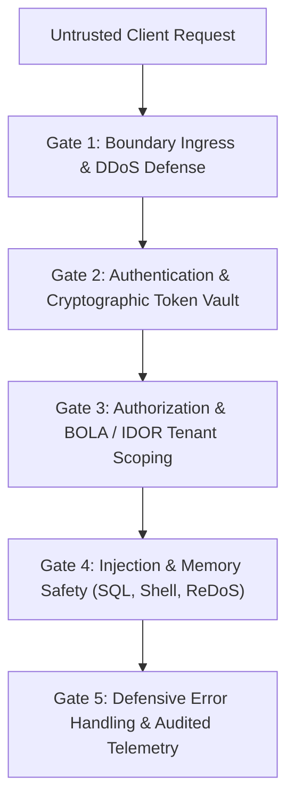

# Security Hardening & Vulnerability Defense (`/security`)

> **Philosophy**: *Assume breach. Defense in depth. Never trust client input. Never interpolate variables into queries or shell commands. Never swallow errors silently. Refresh tokens must rotate with family reuse detection. All object access must be scoped to the tenant. Block private subnets on outbound requests.*

This skill establishes defensive security standards across web applications, APIs, databases, container environments, and secret management lifecycles.

---

## 1. The Five Core Security Gates



1. **Gate 1: Boundary Ingress & DDoS Defense**: Cap request payloads (100KB JSON), enforce connection timeouts (3s / 15s), and throttle traffic with sliding-window / token-bucket rate limits.
2. **Gate 2: Authentication & Token Vault**: Enforce Argon2id password hashing, refresh token family rotation with reuse detection, and constant-time string comparisons.
3. **Gate 3: Authorization & BOLA Scoping**: Every database lookup and mutation MUST include the authenticated `tenant_id` / `user_id` in the `WHERE` clause.
4. **Gate 4: Injection & Memory Safety**: Strictly parameterize all SQL queries, invoke CLI processes using argument arrays (`shell=False`), and eliminate catastrophic backtracking regexes.
5. **Gate 5: Defensive Error Handling**: Prohibit silent error swallowing (`catch (e) {}`). Sanitize internal errors into RFC 7807 Problem Details with unique correlation IDs.

---

## 2. Defensive Error Handling & Fault Isolation

```typescript
// ❌ VULNERABLE: Silent catch swallows error, blinds telemetry, hides failure
try {
  await db.transaction(async (tx) => { ... });
} catch (e) {
  // Silent swallow - system now in corrupt unobserved state!
}

// ❌ VULNERABLE: Leaking internal stack trace and database topology to client
app.use((err, req, res, next) => {
  res.status(500).json({ error: err.message, stack: err.stack });
});

// ✅ DEFENSIVE: Structured RFC 7807 response with sanitized production payload
app.use(createSafeErrorHandler({
  serviceBaseUrl: "https://errors.skillbuilder.io",
  isProduction: process.env.NODE_ENV === "production"
}));
```

- **RFC 7807 Compliance**: Always return `application/problem+json` containing `type`, `title`, `status`, `detail`, `instance`, and `correlationId`.
- **Fault Domains**: Isolate third-party service failures with circuit breakers and fallback defaults.

---

## 3. Authentication & Token Vault Standards

### 3.1 Refresh Token Family Rotation
Never issue static refresh tokens. Track tokens by `family_id`. When a refresh token is exchanged:
1. Mark the presented token as used and issue a new token in the same family.
2. If an already-used token is received, **token reuse is detected**: revoke all tokens in the entire family immediately.

### 3.2 Constant-Time Equality (Mitigating Timing Attacks)
```typescript
import crypto from "node:crypto";

// ✅ DEFENSIVE: Constant-time comparison
export function secureCompare(a: string, b: string): boolean {
  const bufA = Buffer.from(a, "utf8");
  const bufB = Buffer.from(b, "utf8");
  if (bufA.length !== bufB.length) {
    crypto.timingSafeEqual(bufA, bufA);
    return false;
  }
  return crypto.timingSafeEqual(bufA, bufB);
}
```

### 3.3 Cryptographic Standards & Cookies
- **Passwords**: Hash with **Argon2id** (memory cost 64MB, 3 iterations, 4 parallelism) or **bcrypt** with work factor $\ge 12$.
- **Cookie Security**: All authentication cookies must specify `Secure; HttpOnly; SameSite=Lax; Path=/`.

---

## 4. Application-Layer DDoS & Resource Exhaustion Defense

### 4.1 Multi-Tier Rate Limiting Matrix
- **Public Auth Endpoints** (`/auth/login`, `/auth/register`): 5–10 requests/min per IP.
- **Authenticated APIs**: 100–300 requests/min per user/tenant.
- **Quota Headers**: Emit `RateLimit-Limit`, `RateLimit-Remaining`, `RateLimit-Reset`, and `Retry-After`. Return HTTP `429 Too Many Requests`.

### 4.2 Slowloris & Request Caps
- **Connection Handshake**: 3 seconds timeout.
- **Body Reception**: 15 seconds read timeout.
- **Body Size**: Cap JSON bodies to `100kb`.
- **ReDoS Prevention**: Eliminate nested quantifiers (`(a+)+`) and verify regexes against linear execution engines.

---

## 5. OWASP Top 10 & SSRF Defense

### 5.1 Server-Side Request Forgery (SSRF)
When fetching user-provided URLs (webhooks, avatar imports):
1. Whitelist protocol schemes: strictly `http` and `https`.
2. Resolve DNS and inspect resolved IP addresses. Reject:
   - Private subnets (RFC 1918: `10.0.0.0/8`, `172.16.0.0/12`, `192.168.0.0/16`)
   - Loopback (`127.0.0.0/8`, `::1`)
   - Link-local & cloud metadata (`169.254.169.254`)
3. Pin the connection socket to the validated IP to prevent DNS rebinding attacks.

### 5.2 Broken Object Level Authorization (BOLA/IDOR)
Always scope database queries to the authenticated tenant or user:
```sql
-- ✅ Defensive tenant scoping
SELECT * FROM invoices 
WHERE id = $1 AND tenant_id = $2;
```

---

## 6. Security Hygiene Auditor CLI

Scan your repository for hardcoded secrets, unsafe shell executions, SQL interpolations, silent error swallowing, and stack leaks:

```bash
python3 skills/security/scripts/audit_security_hygiene.py --path . --strict
```

Audited Rules:
- `HARDCODED-*-KEY`: Detects exposed API keys, private keys, or tokens.
- `UNSAFE-SQL-INTERPOLATION`: Flags SQL queries built via string interpolation or f-strings.
- `UNSAFE-EVAL-EXEC` / `UNSAFE-SHELL-TRUE`: Catches dynamic code and unescaped shell commands.
- `SILENT-ERROR-SWALLOWING`: Flags empty catch blocks or `except: pass`.
- `SENSITIVE-STACK-LEAK`: Flags leaking raw exception stack traces in HTTP responses.
- `INSECURE-CORS-WILDCARD`: Flags wildcard CORS origins combined with credentials.
- `VULNERABLE-REDOS`: Detects catastrophic backtracking patterns in regexes.

---

## 7. Security Architecture References & Templates

- [`defensive-error-handling-and-resilience.md`](references/defensive-error-handling-and-resilience.md) - Error isolation & RFC 7807.
- [`auth-security-and-token-rotation.md`](references/auth-security-and-token-rotation.md) - Refresh token family rotation & constant-time compare.
- [`ddos-rate-limiting-and-resource-starvation.md`](references/ddos-rate-limiting-and-resource-starvation.md) - Rate limiting & Slowloris timeouts.
- [`owasp-top-10-and-ssrf-defense.md`](references/owasp-top-10-and-ssrf-defense.md) - SSRF post-DNS validation & CSP headers.
- **Production Templates**:
  - [`SafeErrorHandler.ts`](templates/SafeErrorHandler.ts) - RFC 7807 error middleware.
  - [`TokenBucketRateLimiter.ts`](templates/TokenBucketRateLimiter.ts) - Token bucket rate limiter.
  - [`TokenVault.ts`](templates/TokenVault.ts) - Cryptographic token vault & rotation.
  - [`ssrf_guardian.py`](templates/ssrf_guardian.py) - Outbound URL validation & IP pinning.
