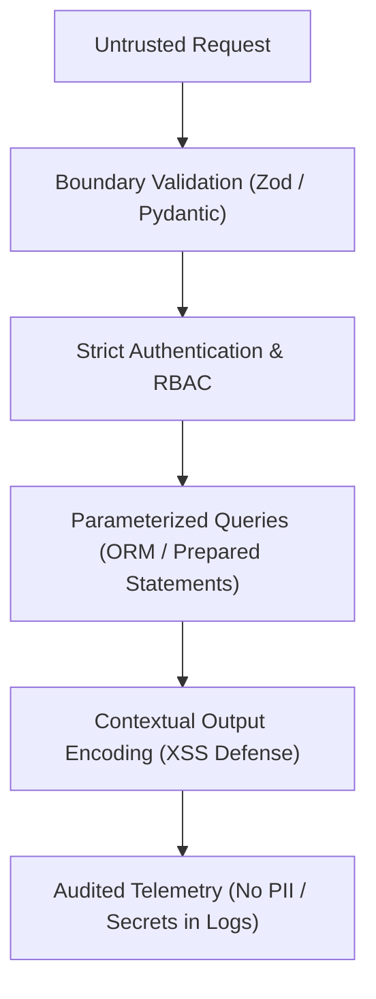

# Security Hardening & Vulnerability Defense (`/security`)

> **Philosophy**: *Assume breach. Defense in depth. Never trust client input. Never interpolate variables into queries or commands. Never hardcode credentials.*

This skill establishes defensive security standards across web applications, APIs, databases, and container environments.

---

## 1. The Core Security Gates



### Gate 1: SQL Injection & Command Injection Prevention
- **Strict Rule**: Never use string interpolation (`f"SELECT... {id}"`, `query = "..." + val`) to construct SQL queries or shell commands (`exec`, `eval`, `shell=True`).
- **Standard**: Always use prepared statements, parameterized query arguments, or schema-validated ORMs.

### Gate 2: Zero Hardcoded Secrets & Credential Hygiene
- **Strict Rule**: Never commit API keys, JWT secrets, database passwords, or private keys to source code or Dockerfiles.
- **Standard**: Load from environment variables (`process.env`, `os.environ`) with fallback to local uncommitted `.env` files guarded by `.gitignore` and `.env.example`.

### Gate 3: Modern OWASP Defense Checklist
1. **XSS Defense**: Use framework-native auto-escaping (React JSX, Angular templates); never use `dangerouslySetInnerHTML` without DOMPurify.
2. **CSRF & SameSite**: Set `SameSite=Lax` or `Strict` on all authentication cookies with `HttpOnly` and `Secure`.
3. **CORS Hardening**: Never use `Access-Control-Allow-Origin: *` alongside `credentials: true`. Explicitly whitelist production origins.
4. **Rate Limiting**: Protect authentication endpoints (`/login`, `/signup`, `/reset-password`) with token bucket or sliding window rate limiting.

---

## 2. Security Hygiene Auditor CLI

Scan your repository for hardcoded secrets, unsafe shell executions, and query interpolations:
```bash
python3 skills/security/scripts/audit_security_hygiene.py --path .
```
