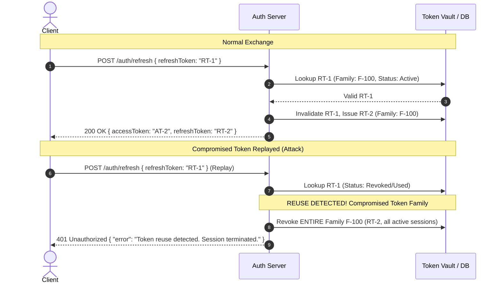

# Authentication Security, Token Rotation & BOLA Defense

> **Philosophy**: *Authentication verifies identity; authorization verifies permission. Never trust client claims without cryptographic verification. Refresh tokens must rotate; compromised tokens must revoke families. Every object access must be scoped to the authenticated tenant.*

---

## 1. Refresh Token Family Rotation & Reuse Detection

Long-lived sessions require refresh tokens. Storing static refresh tokens creates perpetual vulnerability if leaked. **Token Family Rotation** guarantees that every refresh token can be used exactly once.



### Invariants:
1. **Single-Use Refresh Tokens**: When a refresh token is exchanged, it is immediately marked as `used` or deleted, and a new refresh token is issued.
2. **Family Tracking**: Tokens belong to a `family_id`. If an already-used refresh token is presented, the system treats it as an active compromise and **revokes all tokens in that family immediately**.
3. **Short-Lived Access Tokens**: Access tokens must have a lifetime $\le 15$ minutes. Refresh tokens should have a rolling window of 7–14 days.

---

## 2. Constant-Time Equality (Mitigating Timing Attacks)

Standard string equality operators (`===` in JavaScript, `==` in Python) terminate comparisons at the first mismatching byte. Attackers can measure response time variations (sub-microsecond differentials over statistical samples) to deduce signatures, API keys, or password hashes byte by byte.

### Implementation Standards:

#### TypeScript / Node.js
```typescript
import crypto from "node:crypto";

export function timingSafeEqualString(a: string, b: string): boolean {
  const bufA = Buffer.from(a, "utf8");
  const bufB = Buffer.from(b, "utf8");

  if (bufA.length !== bufB.length) {
    // Prevent length leak by running comparison against dummy buffer
    crypto.timingSafeEqual(bufA, bufA);
    return false;
  }
  return crypto.timingSafeEqual(bufA, bufB);
}
```

#### Python
```python
import hmac

def verify_token_constant_time(received_token: str, expected_token: str) -> bool:
    """Uses hmac.compare_digest to prevent byte-by-byte timing attacks."""
    return hmac.compare_digest(
        received_token.encode("utf-8"),
        expected_token.encode("utf-8")
    )
```

---

## 3. Broken Object Level Authorization (BOLA / IDOR) Defense

Broken Object Level Authorization (OWASP API1:2023) occurs when an endpoint accepts an object ID from user input and retrieves or modifies the record without verifying tenant or user ownership.

### Anti-Pattern (Vulnerable):
```typescript
// ❌ VULNERABLE: Any authenticated user can view or mutate document 992
app.get("/api/documents/:id", authenticateUser, async (req, res) => {
  const doc = await db.query("SELECT * FROM documents WHERE id = $1", [req.params.id]);
  return res.json(doc);
});
```

### Defensive Pattern (Tenant-Scoped Queries):
```typescript
// ✅ DEFENSIVE: Query is strictly scoped to req.user.tenantId
app.get("/api/documents/:id", authenticateUser, async (req, res) => {
  const doc = await db.query(
    "SELECT * FROM documents WHERE id = $1 AND tenant_id = $2",
    [req.params.id, req.user.tenantId]
  );
  if (!doc) {
    // Return 404 rather than 403 to prevent object existence enumeration
    return res.status(404).json({
      type: "https://errors.skillbuilder.io/not-found",
      title: "Resource Not Found",
      status: 404,
      detail: `Document ${req.params.id} does not exist.`
    });
  }
  return res.json(doc);
});
```

---

## 4. OAuth2 & PKCE for Client Applications

Mobile and Single-Page Applications (SPAs) are **public clients**; they cannot securely store a `client_secret`. All public OAuth2 flows must implement **Proof Key for Code Exchange (PKCE, RFC 7636)**:

1. **Code Verifier**: High-entropy cryptographically random string (43–128 characters, `[A-Za-z0-9\-._~]`).
2. **Code Challenge**: Base64URL-encoded SHA-256 hash of the verifier (`BASE64URL(SHA256(code_verifier))`).
3. **Authorization Request**: Client sends `code_challenge` and `code_challenge_method=S256`.
4. **Token Exchange**: Client sends `code` and plaintext `code_verifier`. The authorization server recalculates the hash and verifies equality before returning tokens.

---

## 5. Password Hashing & Secret Derivation Standards

| Algorithm | Status | Minimum Recommended Parameters | Forbidden Alternatives |
| :--- | :--- | :--- | :--- |
| **Argon2id** | **Recommended** (OWASP) | `memoryCost: 65536` (64 MB), `timeCost: 3`, `parallelism: 4` | MD5, SHA-1, SHA-256 |
| **bcrypt** | **Approved Legacy** | Work factor / cost: $\ge 12$ ($2^{12}$ iterations) | Plain SHA-2, DES |
| **PBKDF2** | **FIPS-Compliant** | HMAC-SHA512 with $\ge 600,000$ iterations | Fast unsalted hashes |

Passwords must never be truncated. Input lengths must be capped at 128 characters prior to hashing to prevent memory exhaustion attacks against bcrypt/Argon2.
