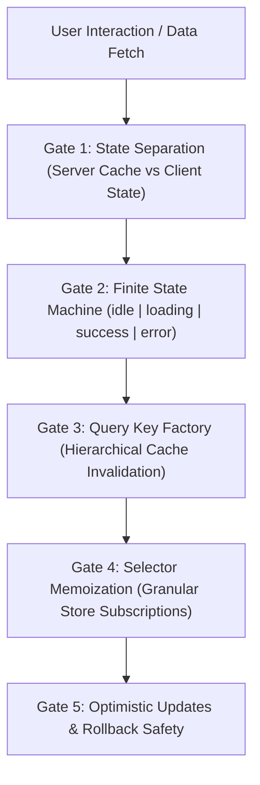

# Declarative State Machines, Cache & Signals (`/state-management`)

> **Philosophy**: *Server state is an asynchronous remote cache; client state is an ephemeral synchronous state machine. Never store remote data in local UI state. Prohibit boolean explosion. Invalidate with Query Key Factories. Memoize store selectors to eliminate re-render cascades.*

This skill establishes production architecture for state management across **TanStack Query (React Query)**, **Zustand**, **Jotai**, **XState**, and **Signals**.

---

## 1. The Core State Architecture Gates



1. **Gate 1: Strict Boundary Separation**: Server state (remote API data) belongs exclusively in TanStack Query. Ephemeral client state (drawer open/closed, form draft) belongs in local state or Zustand.
2. **Gate 2: Zero Boolean Explosion**: Replace uncoordinated flags (`isLoading`, `isError`, `isSuccess`) with a single deterministic state machine enum (`status: 'idle' | 'loading' | 'success' | 'error'`).
3. **Gate 3: Query Key Factories**: Centralize query keys into structured, strongly-typed factory objects (`projectKeys.detail(id)`) for deterministic cache invalidation.
4. **Gate 4: Granular Store Subscriptions**: Always select specific slices (`useStore(state => state.isOpen)`). Never subscribe to the root store object.
5. **Gate 5: Optimistic Mutations with Rollbacks**: Optimistic UI updates must snapshot previous cache state in `onMutate` and roll back on `onError`.

---

## 2. Query Key Factory & TanStack Query (TypeScript)

```typescript
// features/projects/queries/projectKeys.ts
export const projectKeys = {
  all: ["projects"] as const,
  lists: () => [...projectKeys.all, "list"] as const,
  list: (filters: Record<string, unknown>) => [...projectKeys.lists(), filters] as const,
  details: () => [...projectKeys.all, "detail"] as const,
  detail: (id: string) => [...projectKeys.details(), id] as const
};

// Optimistic mutation hook
export function useUpdateProjectTitle() {
  const queryClient = useQueryClient();

  return useMutation({
    mutationFn: ({ id, title }: { id: string; title: string }) => api.updateTitle(id, title),
    onMutate: async ({ id, title }) => {
      await queryClient.cancelQueries({ queryKey: projectKeys.detail(id) });
      const previous = queryClient.getQueryData<Project>(projectKeys.detail(id));

      queryClient.setQueryData<Project>(projectKeys.detail(id), (old) =>
        old ? { ...old, title } : undefined
      );

      return { previous };
    },
    onError: (_err, { id }, context) => {
      if (context?.previous) {
        queryClient.setQueryData(projectKeys.detail(id), context.previous);
      }
    },
    onSettled: (_data, _err, { id }) => {
      queryClient.invalidateQueries({ queryKey: projectKeys.detail(id) });
    }
  });
}
```

---

## 3. Atomic Zustand Slice with Selector Memoization

```typescript
import { create } from "zustand";

interface WorkspaceState {
  isSidebarOpen: boolean;
  activeFilter: string;
  toggleSidebar: () => void;
  setActiveFilter: (filter: string) => void;
}

export const useWorkspaceStore = create<WorkspaceState>((set) => ({
  isSidebarOpen: true,
  activeFilter: "all",
  toggleSidebar: () => set((state) => ({ isSidebarOpen: !state.isSidebarOpen })),
  setActiveFilter: (activeFilter) => set({ activeFilter })
}));

// ✅ DEFENSIVE: Granular memoized selector prevents re-rendering on unrelated state changes
export function useSidebarOpen(): boolean {
  return useWorkspaceStore((state) => state.isSidebarOpen);
}
```

---

## 4. State Management Verification CLI

Audit your codebase for boolean explosions and un-memoized store subscriptions:

```bash
python3 skills/state-management/scripts/verify_state_hygiene.py --path . --strict
```

Audited Rules:
- `STATE-BOOLEAN-EXPLOSION`: Flags components using multiple simultaneous boolean status flags.
- `STATE-UNMEMOIZED-STORE-SUBSCRIPTION`: Flags consuming an entire Zustand/Redux store without a selector.
- `STATE-RAW-STRING-QUERY-KEY`: Flags raw un-namespaced query key strings in `useQuery`.
