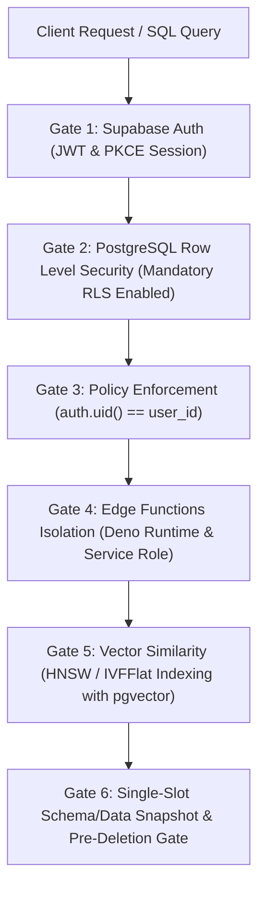

# Supabase Architecture, PostgreSQL RLS & Edge Functions (`/supabase`)

> **Philosophy**: *Mandatory Row Level Security on every table. Client access is untrusted. Zero client exposure of the service_role key. Tenant policies must anchor to auth.uid(). Use prepared statements for pgvector similarity search.*

This skill establishes defensive engineering standards for developing and deploying applications on **Supabase** and **PostgreSQL**.

---

## 1. Quick Navigation & Progressive Disclosure

| Resource Type | Document | Description |
| :--- | :--- | :--- |
| **Reference** | [references/supabase-postgresql-rls.md](references/supabase-postgresql-rls.md) | Mandatory RLS activation, tenant scoping policies, service role quarantine. |
| **Reference** | [references/edge-functions-and-pgvector.md](references/edge-functions-and-pgvector.md) | Deno edge functions, pgvector HNSW indexing, similarity search RPCs. |
| **Utility** | [scripts/verify_supabase_rls.py](scripts/verify_supabase_rls.py) | Audits SQL schemas for unprotected tables, missing RLS policies, and service role leaks in client code. |

---

## 2. The Core Supabase Architecture Gates



1. **Gate 1: PKCE Authentication**: Implement Proof Key for Code Exchange (PKCE) for browser/mobile clients.
2. **Gate 2: Non-Negotiable RLS**: Every table in the `public` schema must execute `ALTER TABLE <table_name> ENABLE ROW LEVEL SECURITY;`.
3. **Gate 3: Tenant Isolation Policies**: Policies must scope rows to `auth.uid()` or verified JWT custom claims (`auth.jwt() ->> 'tenant_id'`).
4. **Gate 4: Service Role Quarantine**: The `service_role` secret key must only be used in secure server environments or Supabase Edge Functions, never client-side.
5. **Gate 5: Vector Indexing**: Multi-dimensional embeddings (`pgvector`) must use `HNSW` or `IVFFlat` indexes with cosine distance (`<=>`).
6. **Gate 6: Deduplicated Pre-Migration Snapshot & Sensitive Deletion Gate**:
   - Before running `supabase db push`, migration scripts, or Supabase Storage bucket mutations, verify or create a single canonical backup keyed by SHA-256 state digest in `.backups/backup_manifest.json` (`manage_deduplicated_backup.py`). Never create spammy duplicate SQL dumps across concurrent agents.
   - Always halt and inform the user first before executing `DROP TABLE`, `TRUNCATE`, or deleting objects/buckets in `storage.objects` / `storage.buckets`.

---

## 2. Hardened Database Migrations & RLS Policies (SQL)

```sql
-- 1. Create tenant-scoped table
CREATE TABLE public.projects (
    id UUID PRIMARY KEY DEFAULT gen_random_uuid(),
    user_id UUID NOT NULL REFERENCES auth.users(id) ON DELETE CASCADE,
    name TEXT NOT NULL CHECK (char_length(name) >= 1 AND char_length(name) <= 100),
    description TEXT,
    created_at TIMESTAMPTZ NOT NULL DEFAULT timezone('utc'::text, now()),
    updated_at TIMESTAMPTZ NOT NULL DEFAULT timezone('utc'::text, now())
);

-- 2. MANDATORY: Enable Row Level Security
ALTER TABLE public.projects ENABLE ROW LEVEL SECURITY;

-- 3. Strict policies scoped to auth.uid()
CREATE POLICY "Users can view their own projects"
    ON public.projects FOR SELECT
    TO authenticated
    USING (auth.uid() = user_id);

CREATE POLICY "Users can create their own projects"
    ON public.projects FOR INSERT
    TO authenticated
    WITH CHECK (auth.uid() = user_id);

CREATE POLICY "Users can update their own projects"
    ON public.projects FOR UPDATE
    TO authenticated
    USING (auth.uid() = user_id)
    WITH CHECK (auth.uid() = user_id);

CREATE POLICY "Users can delete their own projects"
    ON public.projects FOR DELETE
    TO authenticated
    USING (auth.uid() = user_id);
```

---

## 3. Safe Client Initialization & Edge Functions (TypeScript)

### Client Initialization (Zero `service_role` Exposure)
```typescript
import { createClient } from "@supabase/supabase-js";

// ✅ DEFENSIVE: Client uses public anon key only
export const supabase = createClient(
  process.env.NEXT_PUBLIC_SUPABASE_URL!,
  process.env.NEXT_PUBLIC_SUPABASE_ANON_KEY!,
  {
    auth: {
      persistSession: true,
      detectSessionInUrl: true,
      flowType: "pkce"
    }
  }
);
```

---

## 4. Supabase Architecture Verification CLI

Audit your repository for tables missing RLS and exposed service role keys:

```bash
python3 skills/supabase/scripts/verify_supabase_rls.py --path . --strict
```

Audited Rules:
- `SUPABASE-MISSING-RLS`: Flags `CREATE TABLE` without corresponding `ENABLE ROW LEVEL SECURITY`.
- `SUPABASE-EXPOSED-SERVICE-KEY`: Flags client code importing or referencing `SUPABASE_SERVICE_ROLE_KEY`.
- `SUPABASE-PERMISSIVE-POLICY`: Flags insecure open policies like `USING (true)`.
- `SUPABASE-UNSAFE-DESTRUCTIVE-SQL`: Flags `DROP TABLE`, `TRUNCATE`, or `storage.objects` / `storage.buckets` purges lacking `-- @user-approved-deletion` and `-- @verified-backup-sha256`.
