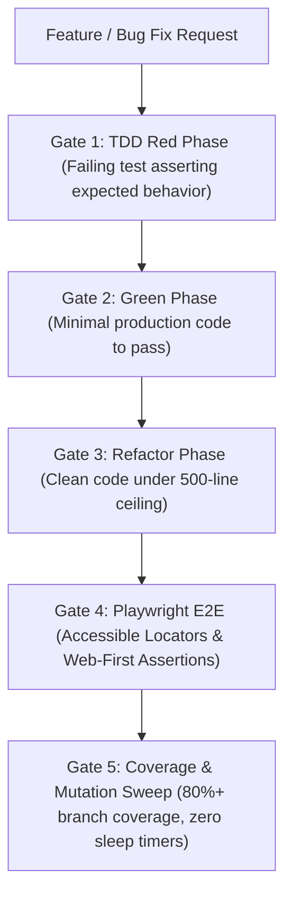

# Test-Driven Discipline, Playwright E2E & Mutation QA (`/testing`)

> **Philosophy**: *Untested code is broken by design. Write failing characterization tests before refactoring. Ban fragile CSS selectors in E2E tests—use accessible roles and semantic labels. Ban hardcoded sleep timers—use auto-waiting web-first assertions. Aim for 80%+ line and branch coverage.*

This skill establishes automated testing discipline across **Vitest**, **Jest**, **Playwright**, **Cypress**, and **Mock Service Worker (MSW)**.

---

## 1. The Core Testing Discipline Gates



1. **Gate 1: Test-Driven Red Phase**: Author unit/contract tests asserting the required behavior before modifying production files.
2. **Gate 2: Accessible E2E Locators**: In Playwright or Cypress, strictly prohibit internal class or DOM selectors (`div > button.btn-12`). Use user-facing accessible locators: `page.getByRole('button', { name: 'Save' })`, `page.getByLabel('Email')`.
3. **Gate 3: Zero Hardcoded Sleep Timers**: Prohibit `page.waitForTimeout()` or `time.sleep()`. Use Playwright web-first assertions (`await expect(locator).toBeVisible()`) that automatically retry until timeout.
4. **Gate 4: Mock Service Worker (MSW)**: Mock network requests at the HTTP transport layer using MSW handlers rather than stubbing internal class methods.
5. **Gate 5: Deterministic Test Isolation**: Every test must run in isolation with ephemeral database transactions or clean fixtures. Tests must never share mutable global state.

---

## 2. Resilient Playwright E2E Test (TypeScript)

```typescript
import { test, expect } from "@playwright/test";

test.describe("User Authentication Flow", () => {
  test("successfully signs in with valid credentials and redirects to dashboard", async ({ page }) => {
    await page.goto("/login");

    // ✅ DEFENSIVE: Accessible user-facing locators
    await page.getByLabel("Email Address").fill("developer@skillbuilder.io");
    await page.getByLabel("Password").fill("SuperSecretPass123!");
    await page.getByRole("button", { name: "Sign In" }).click();

    // ✅ DEFENSIVE: Web-first assertion (auto-retries, zero arbitrary sleep)
    await expect(page).toHaveURL("/dashboard");
    await expect(page.getByRole("heading", { name: "Workspace Overview" })).toBeVisible();
    await expect(page.getByText("Welcome back, Developer")).toBeVisible();
  });
});
```

---

## 3. Vitest Unit Test with Mock Service Worker (TypeScript)

```typescript
import { describe, it, expect, beforeAll, afterEach, afterAll } from "vitest";
import { setupServer } from "msw/node";
import { http, HttpResponse } from "msw";
import { fetchProjects } from "./projectClient";

const server = setupServer(
  http.get("https://api.skillbuilder.io/v1/projects", () => {
    return HttpResponse.json([
      { id: "proj_1", name: "Telemetry Engine", status: "active" }
    ]);
  })
);

beforeAll(() => server.listen({ onUnhandledRequest: "error" }));
afterEach(() => server.resetHandlers());
afterAll(() => server.close());

describe("fetchProjects client", () => {
  it("fetches and deserializes active projects cleanly", async () => {
    const projects = await fetchProjects();
    expect(projects).toHaveLength(1);
    expect(projects[0].name).toBe("Telemetry Engine");
  });
});
```

---

## 4. Testing Hygiene Verification CLI

Audit your test suites for fragile CSS selectors and arbitrary sleep timers:

```bash
python3 skills/testing/scripts/verify_testing_hygiene.py --path . --strict
```

Audited Rules:
- `TESTING-ARBITRARY-SLEEP-TIMER`: Flags `waitForTimeout()` or `time.sleep()` in test suites.
- `TESTING-FRAGILE-CSS-SELECTOR`: Flags non-semantic DOM/CSS selectors in E2E tests (`page.click('div.btn-blue')`).
- `TESTING-EMPTY-ASSERTIONS`: Flags test blocks with zero assertions or `expect()` calls.
