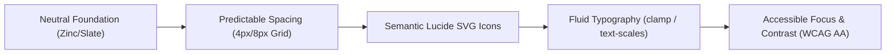

# UI Design Systems & Craftsmanship (`/ui`)

> **Philosophy**: *Form follows function. Reject visual noise, card-soup layouts, and raw emojis. Build high-contrast, accessible interfaces using disciplined tokens and semantic vector icons.*

This skill establishes production design system foundations across React, Next.js, Tailwind CSS v4, and Flutter.

---

## 1. Core UI Craftsmanship Rules



### Rule 1: The Disciplined Neutral Palette
- Use neutral monochrome scales (`zinc-900`, `zinc-800`, `zinc-100`) as primary surfaces.
- Strictly reserve accent colors (e.g. amber, emerald, rose) for purposeful semantic state:
  - **Success / Healthy**: `emerald-500`
  - **Warning / Degraded**: `amber-500`
  - **Destructive / Error**: `rose-500`
  - **Information / Active**: `sky-500`
- Never apply multi-stop neon gradients (`from-purple-600 via-pink-500 to-indigo-600`) unless explicitly branding a creative campaign.

### Rule 2: Lucide Vector Iconography (Zero Emojis in Controls)
- **Strict Prohibition**: Never embed raw emojis (`🔥`, `🚀`, `✨`, `⚙️`) in interactive buttons, headers, or nav menus.
- **Mandate**: Import Lucide SVG icons. Always attach `aria-hidden="true"` when accompanied by text, or `aria-label` when icon-only.

```tsx
// ❌ REJECTED: Raw emoji in button
<button className="px-3 py-2">⚙️ Settings</button>

// ✅ PRODUCTION: Lucide SVG with accessible attributes
import { Settings } from "lucide-react";

<button 
  type="button"
  className="inline-flex items-center gap-2 px-3 py-1.5 text-xs font-medium text-zinc-200 bg-zinc-800 hover:bg-zinc-700 rounded border border-zinc-700 transition-colors focus-visible:ring-2 focus-visible:ring-zinc-400"
>
  <Settings className="w-3.5 h-3.5 text-zinc-400" aria-hidden="true" />
  <span>Settings</span>
</button>
```

### Rule 3: Spacing & Layout Architecture
- Standardize on an 8-point base grid (4px, 8px, 12px, 16px, 24px, 32px, 48px).
- Restrict max layout widths to avoid awkward stretching: `max-w-5xl` for content, `max-w-7xl` for dashboards.
- Use subtle, crisp borders (`border border-zinc-800`) over heavy drop shadows (`shadow-2xl`).

---

## 2. Design Token Verification CLI

Run the token and icon linter across your markup:
```bash
python3 skills/ui/scripts/verify_ui_tokens.py --path .
```
