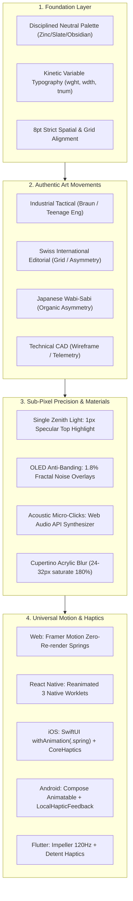

# UI Design Systems & Craftsmanship (`/ui`)

> **Philosophy**: *Form follows function. Reject visual noise, neon purple card-soup, and generic SaaS flatland. Build tactile, high-contrast, mathematically precise interfaces using disciplined tokens, authentic art movements, physical spring dynamics, sub-pixel directional lighting, and semantic vector icons across Web and Universal Mobile.*

This skill establishes production-grade design system foundations across React 19, Next.js, Tailwind CSS v4, React Native, Swift (iOS), Kotlin (Android), Flutter (Dart), and modern cross-platform interfaces.

---

## 1. Core UI Craftsmanship Architecture



---

## 2. Specialized Architectural References

| Document | Scope & Focus | Target Platforms |
| :--- | :--- | :--- |
| [references/premium-ui-craft-and-subpixel-engineering.md](references/premium-ui-craft-and-subpixel-engineering.md) | Sub-pixel directional lighting, Fresnel highlights, OLED anti-banding, tactile travel, and Web Audio click synthesizer. | Web & Universal Mobile |
| [references/unique-art-styles-and-aesthetics.md](references/unique-art-styles-and-aesthetics.md) | Detailed specifications for the 4 Non-Generic Art Movements (Color palettes, typography, UI patterns, and layout rules). | Web & Universal Mobile |
| [references/universal-mobile-motion-architecture.md](references/universal-mobile-motion-architecture.md) | Universal mobile motion guide: Reanimated 3 worklets, SwiftUI spring/haptics, Compose animatables, and Flutter Impeller. | React Native, SwiftUI, Compose, Flutter |
| [references/kinetic-typography-and-variable-fonts.md](references/kinetic-typography-and-variable-fonts.md) | Variable font axes (`wght`, `wdth`, `slnt`, `opsz`, `GRAD`), clip-path text reveals, and tabular numbers across Web & Mobile. | Web, React Native, iOS, Android, Flutter |
| [references/advanced-motion-web-and-flutter.md](references/advanced-motion-web-and-flutter.md) | Harmonic oscillator spring physics parameters ($m\ddot{x} + c\dot{x} + kx = 0$), Framer Motion, and Flutter `unbounded`. | Web & Flutter |

---

## 3. The 4 Non-Generic Art Movements

AI slop universally relies on centered purple cards and generic Inter font. Break out of this flatland using authentic design movements:

### 3.1 Industrial Tactical Functionalism (Dieter Rams / Teenage Engineering)
- **Palette**: Deep matte chassis (`#09090b`), high-contrast technical accents (`#FF4400` safety orange, `#F59E0B` amber).
- **Typography**: Monospace and tabular numbers (`tnum`, `zero`) for telemetry readouts.
- **Components**: Draggable rotary encoder dials, detent tick markings, knurled textures, live oscilloscope displays.

### 3.2 Swiss International Editorial (Müller-Brockmann)
- **Palette**: High-contrast black/white canvas (`#09090b` / `#ffffff`) with stark scarlet red accent (`#E11D48`).
- **Typography**: Architectural sans-serif headlines with tight tracking (`-0.035em`) paired with editorial captions.
- **Components**: Staggered clip-path text reveals, asymmetric editorial split columns, multi-axis variable font interpolation.

### 3.3 Japanese Wabi-Sabi & Organic Tactility
- **Palette**: Warm earthen neutrals (sumi ink `#121214`, washi cream `#F7F6F2`, bamboo `#2E3A2E`).
- **Typography**: Refined transitional serifs paired with restrained geometric sans.
- **Components**: Asymmetric white-space breathing room, gentle spring transitions, subtle grain overlays.

### 3.4 Technical CAD & Wireframe Architecture
- **Palette**: Precision blueprint ink (`#020617`), cyan telemetry (`#06B6D4`), phosphor green (`#10B981`).
- **Typography**: Dense tabular monospace matrices, slashed zeros, coordinate indices.
- **Components**: Orthogonal coordinate grids, crosshair rulers, vector wireframes, spatial dimension annotations.

---

## 4. Sub-Pixel Directional Lighting & Ultra-Premium Craftsmanship

### 4.1 The Single Zenith Light Principle
Every physical container models a 90° overhead ambient light source:
- **Top Specular Hairline**: `inset 0 1px 0 0 rgba(255, 255, 255, 0.12)`.
- **Bottom Ambient Shadow**: `inset 0 -1px 0 0 rgba(0, 0, 0, 0.45)`.
- **Quadratic Contact Shadows**: Multi-stop shadow combining tight 1px contact lines (`0 1px 2px rgba(0,0,0,0.4)`) with diffuse ambient occlusion (`0 20px 40px -15px rgba(0,0,0,0.6)`).

### 4.2 OLED Anti-Banding & Materiality
- Use temperature-tinted obsidian (`#08090a` / `#09090b`) instead of flat `#000000` to prevent OLED purple smear.
- Overlay 1.8% SVG fractal noise to break up 8-bit gradient quantization and impart a bead-blasted aluminum feel.

### 4.3 Zero-Dependency Acoustic Micro-Synthesizer
Inline 1.2ms synthetic click impulses (`2.4kHz` triangle wave with exponential gain decay) via Web Audio API on toggle flips and rotary/fader detent crossing.

---

## 5. Universal Motion Architecture (Web & Mobile)

- **Web (Framer Motion)**: Zero-re-render gestures with `useMotionValue` and `useTransform` directly mutating composite style layers.
- **React Native**: Reanimated 3 UI-thread worklets (`'worklet'`) with zero JS bridge overhead during drag interactions.
- **iOS (SwiftUI)**: Physical springs via `withAnimation(.spring(response: 0.35, dampingFraction: 0.72))` + `UIImpactFeedbackGenerator`.
- **Android (Compose)**: `Animatable.animateTo(spring())` + `LocalHapticFeedback`.
- **Flutter**: `AnimationController.unbounded` + `SpringSimulation` for 120Hz Impeller rendering.

---

## 6. Cupertino Materials Hierarchy

| Material Level | Background Tint | Backdrop Blur | Specular Border | Typical Use Case |
| :--- | :--- | :--- | :--- | :--- |
| **Ultra Thin** | `rgba(24, 24, 27, 0.45)` | `blur(16px)` | `rgba(255, 255, 255, 0.08)` | Sub-panels, hover states, overlays |
| **Thin** | `rgba(24, 24, 27, 0.60)` | `blur(20px)` | `rgba(255, 255, 255, 0.12)` | Secondary sidebars, floating docks |
| **Regular** | `rgba(24, 24, 27, 0.72)` | `blur(28px)` | `rgba(255, 255, 255, 0.15)` | Primary cards, control centers, modals |
| **Thick** | `rgba(18, 18, 22, 0.85)` | `blur(40px)` | `rgba(255, 255, 255, 0.20)` | Persistent navigation bars, headers |

---

## 7. Production Component Templates Catalog

Ready-to-use production components in `skills/ui/templates/`:

| Component Template | Platform / Ecosystem | Aesthetic Movement & Physics | Description |
| :--- | :--- | :--- | :--- |
| **`MachinedTitaniumStrip.tsx`** | Web (React) | Studio Anodized Hardware | Anodized titanium chassis, knurled fader, 16-seg LED meter, Web Audio clicks. |
| **`SpatialCommandPalette.tsx`** | Web (React) | Apple / Linear Spatial UX | Cupertino acrylic refraction, physical 3D keycaps, spring `layoutId` active pill. |
| **`IndustrialTactileEncoder.native.tsx`** | Mobile (React Native) | Industrial Tactical (Reanimated 3) | 120Hz UI-thread worklets, Expo Haptics detents, SVG oscilloscope, tabular numerals. |
| **`IndustrialTactileEncoder.swift`** | Mobile (iOS SwiftUI) | Industrial Tactical (CoreHaptics) | Native SwiftUI drag gesture, `withAnimation(.spring)`, rigid haptics, Canvas waveform. |
| **`IndustrialTactileEncoder.kt`** | Mobile (Android Compose) | Industrial Tactical (Jetpack Compose) | Compose pointerInput, `Animatable` spring, LocalHapticFeedback, Canvas oscilloscope. |
| **`IndustrialTactileEncoder.dart`** | Mobile (Flutter) | Industrial Tactical (Impeller 120Hz) | Unbounded spring dial, `selectionClick()` detent haptics, CustomPainter waveform. |
| **`IndustrialTactileEncoder.tsx`** | Web (React) | Industrial Tactical (Teenage Eng) | Draggable rotary knob, spring detents, live SVG oscilloscope, tabular Hz readout. |
| **`KineticTextReveal.tsx`** | Web (React) | Swiss International Editorial | Staggered clip-path headline reveal, variable-weight hover interpolation. |
| **`MagneticSpatialCard.tsx`** | Web (React) | Spatial 3D / Perspective | Spring-driven tilt, dynamic specular glare tracking, elevated 3D depth. |
| **`AppleGlassCard.tsx`** | Web (React) | Cupertino Acrylic Glass | Multi-layer backdrop blur, specular top-edge highlight, continuous squircle. |
| **`SpatialControlCenter.tsx`** | Web (React) | Apple Spatial Control | Translucent control widget, tactile toggles, continuous range sliders. |
| **`TactileSpringButton.tsx`** | Web (React) | Apple Mass-Spring-Damper | Snappy micro-interaction button with 44x44px accessible touch target. |

---

## 8. Automated Verification CLI

Verify design tokens, prohibited gradients, and icon accessibility automatically:
```bash
python3 skills/ui/scripts/verify_ui_tokens.py --path .
python3 skills/ui/scripts/verify_frontend_quality.py --path .
```
This CLI verifies:
1. Zero raw emojis in button, link, or heading elements.
2. Zero unauthorized arbitrary padding or neon gradient classes.
3. Accessible `aria-hidden="true"` on vector icon instances.
4. WCAG compliant contrast pairings across surface tokens.
5. Presence of 1px specular edge definitions on dark containers.
