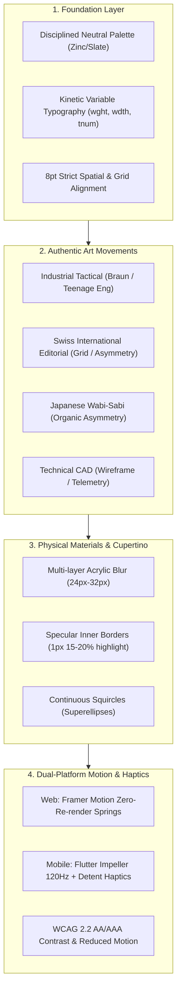

# UI Design Systems & Craftsmanship (`/ui`)

> **Philosophy**: *Form follows function. Reject visual noise, neon purple card-soup, and generic SaaS flatland. Build tactile, high-contrast, mathematically precise interfaces using disciplined tokens, authentic art movements, physical spring dynamics, and semantic vector icons across Web and Mobile.*

This skill establishes production-grade design system foundations across React 19, Next.js, Tailwind CSS v4, Flutter / Dart, and modern cross-platform interfaces.

---

## 1. Core UI Craftsmanship Architecture



---

## 2. Specialized Architectural References

| Document | Scope & Focus | Target Platforms |
| :--- | :--- | :--- |
| [references/unique-art-styles-and-aesthetics.md](references/unique-art-styles-and-aesthetics.md) | Detailed specifications for the 4 Non-Generic Art Movements (Color palettes, typography, UI patterns, and layout rules). | Web & Mobile (Flutter) |
| [references/kinetic-typography-and-variable-fonts.md](references/kinetic-typography-and-variable-fonts.md) | Variable font axes (`wght`, `wdth`, `slnt`, `opsz`, `GRAD`), clip-path text reveals, and tabular numbers. | Web (Framer Motion) & Mobile (Flutter) |
| [references/advanced-motion-web-and-flutter.md](references/advanced-motion-web-and-flutter.md) | Spring physics parameters, Framer Motion zero-re-render gestures, Flutter `AnimationController.unbounded`, and detent haptics. | Web (Framer Motion) & Mobile (Flutter / Impeller) |

---

## 3. The 4 Non-Generic Art Movements

AI slop universally relies on centered purple cards and generic Inter font. Break out of this flatland using authentic design movements:

### 3.1 Industrial Tactical Functionalism (Dieter Rams / Teenage Engineering)
- **Palette**: Deep matte chassis (`#09090b`), high-contrast technical accents (`#FF4400` safety orange, `#F59E0B` amber).
- **Typography**: Monospace and tabular numbers (`tnum`, `zero`) for telemetry readouts.
- **Components**: Draggable rotary encoder dials, detent tick markings, knurled textures, live oscilloscope displays.

### 3.2 Swiss International Editorial (Müller-Brockmann)
- **Palette**: High-contrast black/white canvas (`#09090b` / `#ffffff`) with stark scarlet red accent (`#E11D48`).
- **Typography**: Architectural sans-serif headlines with tight tracking (`-0.035em`) paired with editorial captions.
- **Components**: Staggered clip-path text reveals, asymmetric editorial split columns, multi-axis variable font interpolation.

### 3.3 Japanese Wabi-Sabi & Organic Tactility
- **Palette**: Warm earthen neutrals (sumi ink `#121214`, washi cream `#F7F6F2`, bamboo `#2E3A2E`).
- **Typography**: Refined transitional serifs paired with restrained geometric sans.
- **Components**: Asymmetric white-space breathing room, gentle spring transitions, subtle grain overlays.

### 3.4 Technical CAD & Wireframe Architecture
- **Palette**: Precision blueprint ink (`#020617`), cyan telemetry (`#06B6D4`), phosphor green (`#10B981`).
- **Typography**: Dense tabular monospace matrices, slashed zeros, coordinate indices.
- **Components**: Orthogonal coordinate grids, crosshair rulers, vector wireframes, spatial dimension annotations.

---

## 4. Dual-Platform Motion Architecture

### 4.1 Web: Framer Motion Zero-Re-Render Pipeline
- Avoid updating React state during continuous pointer drag loops.
- Use `useMotionValue` and `useTransform` to mutate DOM transforms directly in the composite layer.
- Enforce spring physics: `stiffness: 380, damping: 28, mass: 1.0` for tactical controls.
- Respect reduced motion via `useReducedMotion()`.

### 4.2 Mobile: Flutter / Dart & Impeller 120Hz GPU Pipeline
- Use `AnimationController.unbounded(vsync: this)` with `SpringSimulation` to prevent clipping spring oscillation overshoots.
- Trigger `HapticFeedback.selectionClick()` on discrete angular detent crossings.
- Use `CustomPainter` with `RepaintBoundary` to keep high-frequency drawing off the widget build tree.
- Check `MediaQuery.of(context).accessibleNavigation` for motion accessibility.

---

## 5. Apple Human Interface & Cupertino Materials

### 5.1 Cupertino Material Hierarchy
| Material Level | Background Tint | Backdrop Blur | Specular Border | Typical Use Case |
| :--- | :--- | :--- | :--- | :--- |
| **Ultra Thin** | `rgba(24, 24, 27, 0.45)` | `blur(16px)` | `rgba(255, 255, 255, 0.08)` | Sub-panels, hover states, overlays |
| **Thin** | `rgba(24, 24, 27, 0.60)` | `blur(20px)` | `rgba(255, 255, 255, 0.12)` | Secondary sidebars, floating docks |
| **Regular** | `rgba(24, 24, 27, 0.72)` | `blur(28px)` | `rgba(255, 255, 255, 0.15)` | Primary cards, control centers, modals |
| **Thick** | `rgba(18, 18, 22, 0.85)` | `blur(40px)` | `rgba(255, 255, 255, 0.20)` | Persistent navigation bars, headers |

---

## 6. Production Component Templates

Ready-to-use production components in `skills/ui/templates/`:

| Component Template | Platform | Aesthetic Movement & Physics | Description |
| :--- | :--- | :--- | :--- |
| **`IndustrialTactileEncoder.tsx`** | Web (React) | Industrial Tactical (Teenage Eng) | Draggable rotary knob, spring detents, live oscilloscope, tabular Hz readout. |
| **`IndustrialTactileEncoder.dart`** | Mobile (Flutter) | Industrial Tactical (Impeller 120Hz) | Unbounded spring dial, `selectionClick()` detent haptics, CustomPainter waveform. |
| **`KineticTextReveal.tsx`** | Web (React) | Swiss International Editorial | Staggered clip-path headline reveal, variable-weight hover interpolation. |
| **`MagneticSpatialCard.tsx`** | Web (React) | Spatial 3D / Perspective | Spring-driven tilt, dynamic specular glare tracking, elevated 3D depth. |
| **`AppleGlassCard.tsx`** | Web (React) | Cupertino Acrylic Glass | Multi-layer backdrop blur, specular top-edge highlight, continuous squircle. |
| **`SpatialControlCenter.tsx`** | Web (React) | Apple Spatial Control | Translucent control widget, tactile toggles, continuous range sliders. |
| **`TactileSpringButton.tsx`** | Web (React) | Apple Mass-Spring-Damper | Snappy micro-interaction button with 44x44px accessible touch target. |

---

## 7. Automated Verification CLI

Verify design tokens, prohibited gradients, and icon accessibility automatically:
```bash
python3 skills/ui/scripts/verify_ui_tokens.py --path .
```
This CLI verifies:
1. Zero raw emojis in button, link, or heading elements.
2. Zero unauthorized arbitrary padding or neon gradient classes.
3. Accessible `aria-hidden="true"` on vector icon instances.
4. WCAG compliant contrast pairings across surface tokens.
