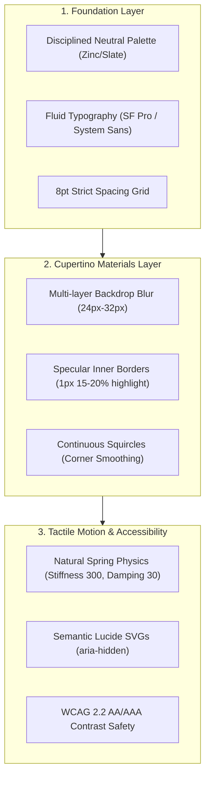

# UI Design Systems & Craftsmanship (`/ui`)

> **Philosophy**: *Form follows function. Reject visual noise, neon purple card-soup, and fake vibe-coding. Build tactile, high-contrast, mathematically precise interfaces using disciplined tokens, Apple Human Interface standards, and semantic vector icons.*

This skill establishes production-grade design system foundations across React 19, Next.js, Tailwind CSS v4, and modern web applications.

---

## 1. Core UI Craftsmanship Architecture



---

## 2. Apple Human Interface Guidelines & Cupertino Aesthetics

### 2.1 The Cupertino Material Hierarchy
Apple interfaces rely on translucent materials that reflect lighting context without degrading readability. Every glass surface must obey physical optical properties:

| Material Level | Background Tint | Backdrop Blur | Saturation | Inner Specular Border | Typical Use Case |
| :--- | :--- | :--- | :--- | :--- | :--- |
| **Ultra Thin** | `rgba(24, 24, 27, 0.45)` | `blur(16px)` | `160%` | `rgba(255, 255, 255, 0.08)` | Sub-panels, hover states, overlays |
| **Thin** | `rgba(24, 24, 27, 0.60)` | `blur(20px)` | `170%` | `rgba(255, 255, 255, 0.12)` | Secondary sidebars, floating docks |
| **Regular** | `rgba(24, 24, 27, 0.72)` | `blur(28px)` | `180%` | `rgba(255, 255, 255, 0.15)` | Primary cards, control centers, modals |
| **Thick** | `rgba(18, 18, 22, 0.85)` | `blur(40px)` | `200%` | `rgba(255, 255, 255, 0.20)` | Persistent navigation bars, status headers |

#### Production Cupertino Acrylic CSS Formula:
```css
.cupertino-material-regular {
  /* Surface Tint */
  background-color: rgba(24, 24, 27, 0.72);
  
  /* Dual-engine backdrop blur with chromatic saturation */
  backdrop-filter: blur(28px) saturate(180%);
  -webkit-backdrop-filter: blur(28px) saturate(180%);
  
  /* Outer hairline separation */
  border: 1px solid rgba(255, 255, 255, 0.10);
  
  /* Specular top-light refraction (Physical glass Fresnel highlight) */
  box-shadow: 
    inset 0 1px 1px 0 rgba(255, 255, 255, 0.18),
    0 20px 40px -15px rgba(0, 0, 0, 0.55);
}
```

### 2.2 Continuous Squircle Curvature (Superellipses)
Standard CSS `border-radius: 16px` creates sharp tangent discontinuities where straight edges meet circular arcs. Apple uses **superellipses** (continuous curvature, exponent $n \approx 4$ or 60% corner smoothing):

1. **Standard Tailwind Approximation**: Combine high radius (`rounded-2xl` or `rounded-3xl`) with inset hairline borders to soften edge transitions.
2. **SVG Masking for Exact Lamé Curves**:
```tsx
// Exact iOS Squircle Path Generator for React
export const SquircleMask: React.FC<{ children: React.ReactNode; width: number; height: number }> = ({
  children,
  width,
  height,
}) => {
  return (
    <div className="relative overflow-hidden" style={{ borderRadius: "24px" }}>
      {/* Specular hairline inner border */}
      <div 
        className="pointer-events-none absolute inset-0 z-10 rounded-[inherit] border border-white/10" 
        aria-hidden="true" 
      />
      {children}
    </div>
  );
};
```

### 2.3 Typography: System Font Tracking & Optical Sizing
Never use decorative, hard-to-read web fonts for functional UI. Standardize on the system font stack (`-apple-system, BlinkMacSystemFont, "SF Pro Text", "SF Pro Display", Inter, sans-serif`):

```css
/* Precise Optical Tracking Matrix */
.text-display {
  font-size: 2.25rem; /* 36px */
  line-height: 2.5rem;
  letter-spacing: -0.035em; /* Tight tracking for large headings */
  font-weight: 700;
}

.text-title {
  font-size: 1.25rem; /* 20px */
  line-height: 1.75rem;
  letter-spacing: -0.02em;
  font-weight: 600;
}

.text-body {
  font-size: 0.875rem; /* 14px */
  line-height: 1.25rem;
  letter-spacing: -0.005em;
  font-weight: 400;
}

.text-caption {
  font-size: 0.75rem; /* 12px */
  line-height: 1rem;
  letter-spacing: 0.015em; /* Relaxed tracking for small legibility */
  font-weight: 500;
}
```

### 2.4 Tactile Spring Physics (No Linear Mud)
Apple interaction relies on mass-spring-damper physics rather than mechanical cubic-beziers:
- **Button Press**: scale down to `0.97`, duration `150ms`, spring damping `0.7`.
- **Card Hover**: scale up to `1.01`, elevation shadow expansion.
- **Toggle Switch**: crisp sliding spring with overshoot damping.

```css
/* Tactile Apple Spring Curve */
.spring-tactile {
  transition-property: transform, box-shadow, background-color;
  transition-duration: 250ms;
  transition-timing-function: cubic-bezier(0.175, 0.885, 0.32, 1.275);
}

@media (prefers-reduced-motion: reduce) {
  .spring-tactile {
    transition: none !important;
    transform: none !important;
  }
}
```

---

## 3. Anti-AI-Slop Visual Commandments

| Prohibited AI Slop | Engineering Mandate | Root Reason |
| :--- | :--- | :--- |
| **Neon Purple / Pink Gradients** (`bg-gradient-to-r from-purple-500 to-indigo-600`) | Deep neutral surfaces (`zinc-900`, `zinc-950`) with single-pixel specular highlights | Neon gradients scream synthetic AI template and cause eye fatigue |
| **Card Soup / Nested Boxes** | Semantic structural flow using whitespace, dividers, and grouped hierarchy | Random rounded cards nested inside other cards clutter comprehension |
| **Raw Emojis in Controls** (`<button>🚀 Deploy</button>`) | Lucide SVG icons (`<Rocket className="w-4 h-4" aria-hidden="true" />`) | Emojis render inconsistently across OSs and fail accessible styling |
| **Glow Halo Borders** (`box-shadow: 0 0 30px #a855f7`) | Inset specular hairlines (`border: 1px solid rgba(255,255,255,0.08)`) | Halos look amateurish and lack physical realism |
| **Low Contrast Grey on Black** | WCAG 2.2 AA compliant tokens (`zinc-100` for primary text, `zinc-400` for secondary) | Readability is paramount for productivity applications |

---

## 4. Production Templates & Reference Implementations

The `/ui` skill includes ready-to-use production components in `skills/ui/templates/`:
- **`AppleGlassCard.tsx`**: Cupertino acrylic material card with specular top highlight, metric badge, and accessible actions.
- **`SpatialControlCenter.tsx`**: macOS / visionOS inspired spatial control widget with multi-layer translucency, tactile toggles, and continuous range sliders.

---

## 5. Automated Verification CLI

Verify design tokens, prohibited gradients, and icon accessibility automatically:
```bash
python3 skills/ui/scripts/verify_ui_tokens.py --path .
```
This CLI verifies:
1. Zero raw emojis in button, link, or heading elements.
2. Zero unauthorized arbitrary padding or neon gradient classes.
3. Accessible `aria-hidden="true"` on vector icon instances.
4. WCAG compliant contrast pairings across surface tokens.
