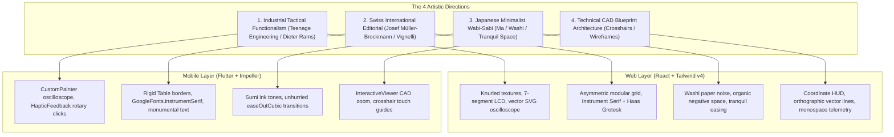

# Unique UI Art Styles & Aesthetics: Web & Mobile Guide

> **Core Axiom**: *Generic AI design computes the statistical average of SaaS templates (Inter font on purple rounded cards). Human-grade craftsmanship selects an intentional artistic movement with deliberate historical roots, tactile affordances, and strict material physics.*

This guide defines four distinct, non-generic art movements for modern software across both **Web (React / Tailwind v4)** and **Mobile (Flutter / Impeller)**.

---

## The 4 Non-Generic Art Movements Matrix

---

## 1. Industrial Tactical Functionalism ("Teenage Engineering / Dieter Rams")

### Philosophy
Originating in Braun audio hardware and Swedish synthesizer engineering (OP-1, TP-7), this style rejects flat sheets of glass. Visual feedback is bound 1:1 to tactile hardware controls (knurled dials, rotary encoders, mechanical switches, and real-time vector oscilloscopes).

### Color & Material Palette:
- **Bone / Chalk Canvas**: `#F5F5F0` (light mode) or **Matte Basalt**: `#161618` (dark mode)
- **Titanium Chassis**: `#262629` (elevated control wells)
- **Functional Accents**: Safety Orange (`#FF4500`), Acid Lime (`#A3E635`), Cadmium Yellow (`#FFD700`)
- **Display Readouts**: 7-segment high-contrast LCD green (`#22C55E`) or amber (`#F59E0B`)

### Cross-Platform Implementation Patterns:
- **Web (React)**:
  - Knurled rotary knobs with pointer drag binding via Framer Motion `useMotionValue` (zero React re-renders).
  - SVG vector oscilloscope modulating harmonic waves directly with knob angle.
- **Mobile (Flutter)**:
  - `GestureDetector` tracking angular motion around center coordinates.
  - `AnimationController.unbounded` running a `SpringSimulation` to snap back to discrete hardware notches.
  - Firing `HapticFeedback.selectionClick()` on every discrete tick division and `HapticFeedback.mediumImpact()` on release.

---

## 2. Swiss International Editorial ("Müller-Brockmann / Vignelli")

### Philosophy
Rooted in the 1950s Swiss Style (Die Neue Graphik), this movement treats typography and the modular grid as primary architecture. Rather than relying on illustrations or drop-shadows, visual impact is created through extreme contrast between serif headlines and grotesque body copy, monumental numerals, and rigid hairline dividers.

### Typography & Spacing:
- **Display Headings**: High-contrast modern editorial serif (`Instrument Serif`, `Newsreader`, `Playfair Display`).
- **Body & Captions**: Precision neo-grotesque (`Neue Haas Grotesk`, `Geist`, `SF Pro Text`).
- **Scale Contrast**: Severe typographic scale jumps ($1.333$ to $1.618$ golden ratio). A $64\text{ px}$ headline placed directly adjacent to an $11\text{ px}$ uppercase tracking-wide label.
- **Architectural Rules**: Crisp $1\text{ px}$ solid borders dividing content blocks with zero rounded corners (`rounded-none`).

### Cross-Platform Implementation Patterns:
- **Web**: Asymmetric CSS Grid with explicit row and column lines (`border-r border-b border-zinc-800`).
- **Mobile (Flutter)**: `Table` with `TableBorder.all(color: Colors.white24, width: 1.0)` and `GoogleFonts.instrumentSerif()`.

---

## 3. Japanese Minimalist Wabi-Sabi ("Ma & Washi")

### Philosophy
Centering on *Ma* (間)—the Japanese aesthetic concept that negative space is not "empty", but an active, breathing presence filled with potential. It embraces subtle organic textures, tranquil pacing, and deliberate asymmetry.

### Color & Material Palette:
- **Sumi Ink**: `#121214` (deep organic black with warm charcoal undertones)
- **Washi Paper**: `#EFEFEA` (warm fibrous paper white)
- **Moss & Earth Accents**: `#4A5548` (subdued matcha green), `#C8A27A` (raw cedar)
- **Texture**: Fine micro-noise shader or SVG grain pattern eliminating sterile digital gradients.

### Motion Dynamics:
- Zero snappy mechanical bounces. Transitions are tranquil, unhurried, and critically damped:
  - Duration: $400\text{--}600\text{ ms}$
  - Curve: `Curves.easeOutCubic` or `cubic-bezier(0.16, 1, 0.3, 1)`
  - Stagger: Soft, organic opacity fades with minimal vertical displacement ($4\text{ px}$).

---

## 4. Technical CAD / Blueprint Architecture

### Philosophy
Inspired by engineering schematics, architectural CAD software, and aerospace telemetry HUDs. It treats the user interface as a high-precision measurement workspace.

### Key Visual Tokens:
- **Coordinate Telemetry**: Real-time cursor coordinates (`X: 412.50 Y: 189.20`) rendered in monospaced fonts (`JetBrains Mono`, `Geist Mono`).
- **Measurement Tick Marks**: $4\text{ px}$ hairline registration crosses at grid intersections (`+`).
- **Orthographic Wireframes**: Isometric and 2D vector projections with $1\text{ px}$ stroke weights and zero fill.
- **Subtle Blueprint Blue / Grid**: Dark slate canvas (`#0B0F19`) with blueprint cyan grid lines (`#1E293B`).

### Cross-Platform Implementation Patterns:
- **Web**: Canvas or SVG overlay tracking `pointermove` to render dynamic crosshairs aligned to the cursor.
- **Mobile (Flutter)**: `InteractiveViewer` with a custom `CustomPainter` drawing an endless CAD grid with zoom-level level-of-detail (LOD) tick divisions.
