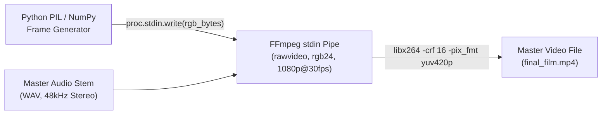

# High-Throughput Python-to-FFmpeg Video Streaming Pipeline

Architectural guide for streaming raw frames directly from Python memory into FFmpeg stdin with zero temporary disk I/O.

---

## 1. Pipeline Architecture

Writing individual PNG frames to disk produces extreme SSD wear and slows render speed to ~10–12 FPS. Instead, streaming uncompressed `rawvideo` RGB24 bytes into FFmpeg stdin achieves 30–35+ FPS real-time rendering.



## 2. Standard Subprocess Invocation

```python
import subprocess
import numpy as np

W, H, FPS = 1920, 1080, 30
audio_wav = "assets/showcase_soundtrack.wav"
output_mp4 = "assets/showcase_film.mp4"

ffmpeg_cmd = [
    "ffmpeg", "-y",
    "-f", "rawvideo",
    "-vcodec", "rawvideo",
    "-s", f"{W}x{H}",
    "-pix_fmt", "rgb24",
    "-r", str(FPS),
    "-i", "-",               # Video stream from stdin
    "-i", audio_wav,         # Synchronized master audio
    "-c:v", "libx264",
    "-preset", "medium",
    "-crf", "16",            # High visual quality, pristine text outlines
    "-pix_fmt", "yuv420p",   # Broad hardware compatibility
    "-c:a", "aac",
    "-b:a", "320k",
    "-shortest",
    output_mp4
]

proc = subprocess.Popen(
    ffmpeg_cmd,
    stdin=subprocess.PIPE,
    stdout=subprocess.DEVNULL,
    stderr=subprocess.PIPE
)

# Frame writing loop
for frame_idx in range(total_frames):
    rgb_frame: np.ndarray = generate_frame(frame_idx)  # (1080, 1920, 3) uint8
    proc.stdin.write(rgb_frame.tobytes())

proc.stdin.close()
proc.wait()
```

## 3. High-Quality Stream Flags

- `-crf 16`: Constant Rate Factor 16 preserves razor-sharp Swiss typography without H.264 macroblock compression artifacts.
- `-pix_fmt yuv420p`: Required for standard HTML5 browser video playback (`<video>` tag).
- `-shortest`: Truncates video to match the audio duration exactly, preventing trailing black frames.
