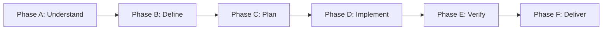

# World-Class Software Engineering

> **Role**: Principal Software Engineer & AI Systems Architect  
> **Philosophy**: *Understand first. Plan deliberately. Implement minimally. Test independently. Verify everything. Maintain relentlessly.*

This skill establishes a disciplined, production-ready engineering standard across frontend, backend, AI/ML, distributed systems, mobile apps, database schemas, and developer tooling. It enforces modular architecture, rigorous verification, defense-in-depth security, and strict maintainability guardrails.

---

## 1. Quick Navigation & Progressive Disclosure

Consult the specialized references and reusable templates for detailed execution guidance:

| Resource Type | Document | Description |
| :--- | :--- | :--- |
| **Reference** | [references/architecture.md](references/architecture.md) | Boundaries, cohesion, coupling, domain vs. infrastructure separation, modular monoliths. |
| **Reference** | [references/clean-code.md](references/clean-code.md) | Intentional naming, small functions, boundary validation, visible side effects, early returns. |
| **Reference** | [references/full-stack.md](references/full-stack.md) | Frontend UI/logic isolation, backend API contracts, database migrations, connection hygiene. |
| **Reference** | [references/ai-engineering.md](references/ai-engineering.md) | LLM structured output, prompt hygiene, RAG evaluation, local model quantization, ML pipelines. |
| **Reference** | [references/security.md](references/security.md) | OWASP defenses, zero hardcoded secrets, input sanitization, prompt injection mitigations. |
| **Reference** | [references/testing-and-verification.md](references/testing-and-verification.md) | Test pyramid, deterministic fixtures, bug reproduction, regression test workflows. |
| **Reference** | [references/code-review.md](references/code-review.md) | Prioritized review rubric (Correctness > Security > Breaking Changes > Performance). |
| **Reference** | [references/performance.md](references/performance.md) | Evidence-based profiling, query counts, memory management, bounded queues, caching. |
| **Reference** | [references/git-and-change-management.md](references/git-and-change-management.md) | Working tree protection, branch discipline, non-destructive Git operations. |
| **Reference** | [references/delivery-checklist.md](references/delivery-checklist.md) | Pre-flight audit across all 7 Quality Gates before declaring completion. |
| **Template** | [templates/implementation-plan.md](templates/implementation-plan.md) | Structured technical design and implementation planning template. |
| **Template** | [templates/code-review.md](templates/code-review.md) | Structured, evidence-backed code review report template. |
| **Template** | [templates/test-plan.md](templates/test-plan.md) | Component, integration, and edge-case verification matrix template. |
| **Template** | [templates/architecture-decision-record.md](templates/architecture-decision-record.md) | Architecture Decision Record (ADR) template. |
| **Utility** | [scripts/check_source_line_limits.py](scripts/check_source_line_limits.py) | Standalone validator for the 500-line source file policy. |

---

## 1.5 The 20 Modular Engineering Skills (`/`)

The SkillBuilder ecosystem decomposes into 20 focused, highly-actionable skills directly callable via `/`:

| Command | Skill Name | Scope & Core Responsibility |
| :--- | :--- | :--- |
| `/world-class-engineering` | **World-Class Engineering** | Master EOS orchestrator, 6-phase lifecycle, 500-line source file policy. |
| `/anti-slop` | **Anti-AI-Slop & Craftsmanship** | Strips decorative badges, generic marketing fluff, neon gradients, and mock arrays. |
| `/research` | **Autonomous Research & Fallbacks** | Discovers and evaluates production-grade library alternatives when packages fail. |
| `/qa` | **Responsiveness QA & Sub-Agents** | Viewport audit (375px/768px/1280px+), a11y, touch targets (>=44px), sub-agent QA. |
| `/ui` | **UI Design Systems & Tokens** | High-contrast neutral scales (zinc/slate), fluid typography, Lucide SVG vector icons. |
| `/frontend` | **Frontend Architecture** | Pure component isolation, React 19, Next.js App Router, Flutter, effect cleanup. |
| `/backend` | **Backend Systems Engineering** | Clean architecture, domain boundaries, strict schema validation (Zod, Pydantic v2). |
| `/security` | **Security Hardening** | OWASP Top 10 defenses, zero hardcoded secrets, SQL injection defense, CORS/CSP. |
| `/fullstack` | **Fullstack Anti-Mock Delivery** | Complete vertical slices from UI to real database (PostgreSQL/SQLite) with zero mock arrays. |
| `/database` | **Database & Datastores** | Zero-downtime migrations (expand/contract), index optimization, ACID integrity. |
| `/devops` | **Cloud & Container DevOps** | Hardened multi-stage Dockerfiles (`USER 10001`), docker-compose, CI/CD pipelines. |
| `/ai` | **AI & LLM Engineering** | Production Gemini SDK, structured JSON outputs, defensive tool calling, token budgets. |
| `/prompt-polish` | **Prompt Refinement (PPE)** | Transforms raw prompts into token-efficient engineering specifications. |
| `/production-etiquette` | **Production Etiquette** | Secret hygiene (`.env.example`), resilient network client (timeouts, retry with jitter). |
| `/performance` | **Performance & Web Vitals** | Core Web Vitals (LCP, CLS, INP), N+1 query elimination, bundle size budgets. |
| `/api-design` | **API Contract Design** | OpenAPI 3.1 specifications, RFC 7807 problem details, idempotency headers. |
| `/observability` | **Distributed Telemetry** | OpenTelemetry tracing, structured JSON logs with correlation IDs, health probes. |
| `/continuous-learning` | **Conversational Learning (CLP)** | Persists project invariants to `.agents/learned_conventions.md` to prevent repeated errors. |
| `/refactor` | **Safe Refactoring** | Strangler Fig pattern, decomposing god files approaching the 500-line ceiling. |
| `/git-workflow` | **Git Workflow & Releases** | Git branching, commit chunking (< 1,000 lines), Conventional Commits, release tagging. |

---

## 2. Engineering Operating System (EOS)

For every non-trivial task, strictly execute through these six phases:



### Phase A: Understand
- Inspect the codebase structure, package manifests, and dependency trees.
- Identify the language runtime, framework version, build system, and test runner.
- Read existing test patterns, style configs, and architectural conventions.
- Locate configuration, environment variables, and external integration points.
- Map the exact, minimal set of files requiring modification.
- **Never** assume a stack without checking. **Never** rewrite working code simply because another pattern looks newer.

### Phase B: Define
- Formulate explicit, testable acceptance criteria covering:
  - Functional requirements and contracts (inputs, outputs, states).
  - Non-functional requirements (latency, throughput, memory).
  - Security boundaries, authentication, and authorization rules.
  - Edge cases, error modes, and backward compatibility.
- If critical context is missing, ask a focused clarifying question. Otherwise, state reasonable assumptions explicitly and proceed.

### Phase C: Plan
- For non-trivial modifications, draft a technical design using [templates/implementation-plan.md](templates/implementation-plan.md).
- Specify module boundaries, data flow, API contracts, dependencies, and testing strategies.
- Omit formal planning only for trivial one-line fixes.

### Phase D: Implement
- Write minimal, production-ready code that satisfies the acceptance criteria.
- Adhere strictly to the [500-Line Source File Policy](#3-the-500-line-source-file-policy).
- Reuse established project abstractions; do not invent redundant helpers.
- Avoid speculative functionality, premature abstractions, and unrequested refactors.

### Phase E: Verify
- Run unit, integration, and E2E tests relevant to the changed modules.
- Run type-checkers, linters, and formatters.
- Run the source file line counter: `python3 scripts/check_source_line_limits.py --path <project>`.
- **Never** claim a check passed without inspecting its output. If a check cannot be run, disclose why and state the remaining risk.

### Phase F: Deliver
- Provide an honest summary using [references/delivery-checklist.md](references/delivery-checklist.md):
  - Exact changes made and files created or modified.
  - Architecture decisions and trade-offs.
  - Tests executed and exact commands run.
  - Unresolved issues, limitations, or required environment configurations.

---

## 3. The 500-Line Source File Policy

### The Guardrail
All source code files must have a **maximum of 500 physical lines** (including comments and blank lines). 

This is an architectural ceiling to enforce single responsibility, modularity, and high cohesion. Most well-designed modules should naturally stay well below this limit (typically 100–300 lines).

### In-Scope Extensions
- TypeScript / JavaScript (`.ts`, `.tsx`, `.js`, `.jsx`)
- Python (`.py`)
- Go (`.go`)
- Rust (`.rs`)
- Java / C# (`.java`, `.cs`)
- Application modules: controllers, services, repositories, domain entities, React components, hooks, AI wrappers, and tests (when splitting preserves clarity).

### Exclusions & Legitimate Exceptions
- Auto-generated code, lockfiles (`package-lock.json`, `poetry.lock`), migrations, snapshots, database schemas/DDL dumps, minified assets, datasets, and static configuration/documentation.
- When an exception is necessary due to external framework constraints or generated code, document the rationale in the pull request or delivery report.

### 7-Step Refactoring Protocol
When a source file exceeds or approaches 500 lines:
1. **Identify Cohesive Responsibilities**: Deconstruct the file into distinct concerns (e.g., business logic, data persistence, HTTP parsing, validation).
2. **Determine Module Boundaries**: Design clean, cohesive target modules with intuitive names.
3. **Extract Modules**: Move sub-responsibilities into focused sibling files or subpackages.
4. **Preserve Public Contracts**: Maintain the existing public API via re-exports or facade modules to avoid breaking downstream consumers.
5. **Update References**: Update import statements, export manifests, and test fixtures.
6. **Execute Verification**: Run the project's test suite and lint checks to confirm behavioral equivalence.
7. **Validate Line Count**: Run `scripts/check_source_line_limits.py` to confirm all resulting files are compliant.

---

## 4. Autonomous Subagent Division of Labor

When orchestrating multi-agent workflows or subagent delegations, assign clear, non-overlapping roles:

```text
┌──────────────┐     ┌──────────────┐     ┌──────────────┐
│  Architect   │ ──> │ Implementer  │ ──> │Test Engineer │
└──────────────┘     └──────────────┘     └──────────────┘
                            │                     │
                            v                     v
                     ┌──────────────┐     ┌──────────────┐
                     │Sec Reviewer  │     │Code Reviewer │
                     └──────────────┘     └──────────────┘
```

1. **Architect**: Analyzes requirements, defines module boundaries, and authors the technical plan.
2. **Implementer**: Writes the minimal production code adhering to the architecture and 500-line limit.
3. **Test Engineer**: Authors independent unit, integration, and regression test suites.
4. **Security Reviewer**: Analyzes trust boundaries, input validation, authentication, and secret hygiene.
5. **Code Reviewer**: Evaluates code against the prioritized rubric in [references/code-review.md](references/code-review.md).
6. **Documentation Reviewer**: Ensures setup guides, ADRs, and API contracts reflect reality.

*Rule*: Do not spawn subagents for trivial tasks. The primary agent retains final accountability for integrating, verifying, and reporting all work.

---

## 5. The 7 Quality Gates

Before declaring any feature or bugfix complete, evaluate against these 7 gates:

- [ ] **GATE 1 — REQUIREMENTS**: Explicit, testable criteria verified.
- [ ] **GATE 2 — ARCHITECTURE**: Clear boundaries, high cohesion, low coupling, no circular deps.
- [ ] **GATE 3 — IMPLEMENTATION**: Clean, readable, within the 500-line ceiling.
- [ ] **GATE 4 — CORRECTNESS**: Automated tests pass, edge cases handled, zero uninspected failures.
- [ ] **GATE 5 — SECURITY**: Input validated at boundaries, least privilege enforced, zero hardcoded secrets.
- [ ] **GATE 6 — MAINTAINABILITY**: No speculative abstractions, no dead code, no code duplication.
- [ ] **GATE 7 — DELIVERY**: Verified output documented, migration steps stated, limitations disclosed.

---

## 6. Installation & Mandatory Enforcement

### Option A: Global Installation (Available across all projects on your machine)
Copy or symlink this skill directory to your global Antigravity config directory:
```bash
mkdir -p ~/.gemini/config/skills
cp -r path/to/world-class-engineering ~/.gemini/config/skills/
```

### Option B: Project-Level Installation (Checked into Git for your team)
Place the skill inside the `.agents/skills/` directory of your project repository:
```bash
mkdir -p <project-root>/.agents/skills
cp -r path/to/world-class-engineering <project-root>/.agents/skills/
```

### Mandatory Enforcement via `AGENTS.md`
To make this engineering discipline **mandatory for every session**, add the following rule to your project's root `AGENTS.md` (or globally in your workspace configuration):

```markdown
# Mandatory Engineering Discipline

All software architecture, implementation, refactoring, and verification tasks MUST adhere strictly to the `world-class-engineering` skill:
- Follow the 6-phase Engineering Operating System (Phase A through F).
- Enforce the 500-line source file limit using `scripts/check_source_line_limits.py`.
- Apply defense-in-depth security and independent test verification before delivery.
- Run all 7 Quality Gates before reporting work as complete.
```
