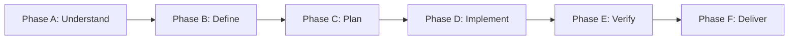

# World-Class Software Engineering

> **Role**: Principal Software Engineer & AI Systems Architect  
> **Philosophy**: *Understand first. Plan deliberately. Implement minimally. Test independently. Verify everything. Maintain relentlessly.*

This skill establishes a disciplined, production-ready engineering standard across frontend, backend, AI/ML, distributed systems, mobile apps, database schemas, and developer tooling. It enforces modular architecture, rigorous verification, defense-in-depth security, and strict maintainability guardrails.

---

## 1. Quick Navigation & Progressive Disclosure

Consult the specialized references and reusable templates for detailed execution guidance:

| Resource Type | Document | Description |
| :--- | :--- | :--- |
| **Reference** | [references/architecture.md](references/architecture.md) | Boundaries, cohesion, coupling, domain vs. infrastructure separation, modular monoliths. |
| **Reference** | [references/clean-code.md](references/clean-code.md) | Intentional naming, small functions, boundary validation, visible side effects, early returns. |
| **Reference** | [references/full-stack.md](references/full-stack.md) | Frontend UI/logic isolation, backend API contracts, database migrations, connection hygiene. |
| **Reference** | [references/ai-engineering.md](references/ai-engineering.md) | LLM structured output, prompt hygiene, RAG evaluation, local model quantization, ML pipelines. |
| **Reference** | [references/security.md](references/security.md) | OWASP defenses, zero hardcoded secrets, input sanitization, prompt injection mitigations. |
| **Reference** | [references/testing-and-verification.md](references/testing-and-verification.md) | Test pyramid, deterministic fixtures, bug reproduction, regression test workflows. |
| **Reference** | [references/code-review.md](references/code-review.md) | Prioritized review rubric (Correctness > Security > Breaking Changes > Performance). |
| **Reference** | [references/performance.md](references/performance.md) | Evidence-based profiling, query counts, memory management, bounded queues, caching. |
| **Reference** | [references/git-and-change-management.md](references/git-and-change-management.md) | Working tree protection, branch discipline, non-destructive Git operations. |
| **Reference** | [references/delivery-checklist.md](references/delivery-checklist.md) | Pre-flight audit across all 7 Quality Gates before declaring completion. |
| **Template** | [templates/implementation-plan.md](templates/implementation-plan.md) | Structured technical design and implementation planning template. |
| **Template** | [templates/code-review.md](templates/code-review.md) | Structured, evidence-backed code review report template. |
| **Template** | [templates/test-plan.md](templates/test-plan.md) | Component, integration, and edge-case verification matrix template. |
| **Template** | [templates/architecture-decision-record.md](templates/architecture-decision-record.md) | Architecture Decision Record (ADR) template. |
| **Utility** | [scripts/check_source_line_limits.py](scripts/check_source_line_limits.py) | Standalone validator for the 500-line source file policy. |

---

## 1.5 The 36 Modular Engineering Skills (`/`)

The SkillBuilder ecosystem decomposes into 36 focused, synchronized skills directly callable via `/`:

| Command | Skill Name | Scope & Core Responsibility |
| :--- | :--- | :--- |
| `/full-scale-mode` | **Full-Scale Mode** | Master Phased Project Orchestration Engine (aliased with `/world-class-engineering`), 3-phase Triad Cadence (Frontend, Backend, Testing), parallel subagent swarms. |
| `/world-class-engineering` | **World-Class Engineering** | Master architecture orchestrator, 3-phase Triad Cadence, 500-line source file policy (aliased with `/full-scale-mode`). |
| `/antigravity-automation` | **Antigravity Automation** | Scheduled sidecars (`~/.gemini/jetski/sidecars/`), in-session timers, lifecycle hooks (`hooks.json`), and reactive subagent execution. |
| `/anti-slop` | **Anti-AI-Slop & Craftsmanship** | Strips decorative badges, generic marketing fluff, neon gradients, and mock arrays. |
| `/research` | **Autonomous Research & Fallbacks** | Discovers and evaluates production-grade library alternatives when packages fail. |
| `/qa` | **Responsiveness QA & Sub-Agents** | Viewport audit (375px/768px/1280px+), a11y, touch targets (>=44px), sub-agent QA. |
| `/ui` | **UI Design Systems & Tokens** | Apple HIG, Cupertino blur materials, squircle smoothing, high-contrast neutrals, Lucide SVGs. |
| `/mobile-ui` | **Native Mobile UI/UX** | iOS 18/19 HIG, SwiftUI matchedGeometry, Material 3 Expressive, safe areas, and haptics. |
| `/web-ui` | **Modern Web Design Systems** | Container queries (`@container`), CSS View Transitions, OKLCH colors, fluid `clamp()` curves. |
| `/3d` | **3D WebGL & Product Showcase** | Three.js, React Three Fiber, PBR clearcoat shaders, Draco GLTF compression, 60fps budgets. |
| `/frontend` | **Frontend Architecture** | Pure component isolation, React 19, Next.js App Router, Flutter, effect cleanup. |
| `/routing` | **File-Based Routing** | Deep layout hierarchies, parallel/intercepting routes, and typed search params. |
| `/state-management` | **Declarative State Machines** | TanStack Query key factories, Zustand sliced stores, XState machines, and signals. |
| `/i18n` | **Internationalization** | Multi-locale dictionaries, ICU MessageFormat, and bidirectional RTL layout mirroring. |
| `/backend` | **Backend Systems Engineering** | Clean architecture, domain boundaries, strict schema validation (Zod, Pydantic v2). |
| `/security` | **Security Hardening** | OWASP Top 10 defenses, zero hardcoded secrets, SQL injection defense, CORS/CSP. |
| `/fullstack` | **Fullstack Anti-Mock Delivery** | Complete vertical slices from UI to real database (PostgreSQL/SQLite) with zero mock arrays. |
| `/database` | **Database & Datastores** | Zero-downtime migrations (expand/contract), single-slot SHA-256 backups, pre-deletion user gate. |
| `/gcp` | **Google Cloud Platform** | Cloud Run serverless deployment, Workload Identity, Cloud SQL/GCS deletion protection. |
| `/aws` | **Amazon Web Services** | Resilient Lambda, S3 public blocks, KMS encryption, `RemovalPolicy.RETAIN` backup hygiene. |
| `/firebase` | **Firebase & Firestore** | Firestore Security Rules v2, atomic transactions, single-slot exports, soft-delete guards. |
| `/supabase` | **Supabase & Postgres RLS** | Mandatory Row Level Security (RLS), Edge Functions, pgvector, pre-migration snapshots. |
| `/data-pipelines` | **Resilient Data Pipelines** | Streaming ETL with backpressure, DuckDB in-process analytics, and Dead-Letter Queues (DLQ). |
| `/devops` | **Cloud & Container DevOps** | Hardened multi-stage Dockerfiles (`USER 10001`), docker-compose, CI/CD pipelines. |
| `/ai` | **AI & LLM Engineering** | Production Gemini SDK, structured JSON outputs, defensive tool calling, token budgets. |
| `/local-llm` | **Local LLM & Edge AI** | Quantized inference (GGUF Q4_K_M), Ollama, MLX, WebLLM, GBNF grammars, hybrid routing. |
| `/prompt-polish` | **Prompt Refinement (PPE)** | Transforms raw prompts into token-efficient engineering specifications. |
| `/production-etiquette` | **Production Etiquette** | Secret hygiene (`.env.example`), resilient network client (timeouts, retry with jitter). |
| `/performance` | **Performance & Web Vitals** | Core Web Vitals (LCP, CLS, INP), N+1 query elimination, bundle size budgets. |
| `/api-design` | **API Contract Design** | OpenAPI 3.1 specifications, RFC 7807 problem details, idempotency headers. |
| `/observability` | **Distributed Telemetry** | OpenTelemetry tracing, structured JSON logs with correlation IDs, health probes. |
| `/testing` | **TDD & Test Automation** | TDD red-green-refactor, Vitest/Jest, Playwright accessible ARIA locators, MSW mocking. |
| `/continuous-learning` | **Conversational Learning (CLP)** | Persists project invariants to `.agents/learned_conventions.md` to prevent repeated errors. |
| `/project-skills` | **Autonomous Skill Minting** | Skill Synthesis Protocol (SSP) minting repository-specific skills in `.agents/skills/`. |
| `/refactor` | **Safe Refactoring** | Strangler Fig pattern, decomposing god files approaching the 500-line ceiling. |
| `/git-workflow` | **Git Workflow & Releases** | Git branching, commit chunking (< 1,000 lines), Conventional Commits, release tagging. |

---

## 1.6 Antigravity Slash Command Synergy Strategy

To achieve maximum output quality, combine Antigravity native commands with specialized modular skills in a single prompt:

- **Full-Scale Feature Planning**: `/plan /full-scale-mode` (or `/plan /world-class-engineering`)
  - Activates Antigravity's interactive planning engine while strictly enforcing the 3-phase Triad Cadence, token budget ceilings, and subagent orchestration.
- **Modern Luxury UI & Apple Craftsmanship**: `/plan /ui /3d <product showcase>`
  - Combines Cupertino blur acrylic materials with WebGL PBR clearcoat 3D rendering for Tesla/Apple caliber interactive experiences.
- **Full-Stack Vertical Slice**: `/plan /fullstack /database /backend <feature>`
  - Guarantees zero mock arrays, real SQLite/PostgreSQL schemas, Zod API contracts, and optimistic frontend mutations.
- **Architectural Alignment Interview**: `/grill-me /world-class-engineering <system>`
  - Triggers an interactive Socratic design review to resolve trade-offs before generating code.

---

## 2. Engineering Operating System (EOS)

For every non-trivial task, strictly execute through these six phases:



### Phase A: Understand
- Inspect the codebase structure, package manifests, and dependency trees.
- Identify the language runtime, framework version, build system, and test runner.
- Read existing test patterns, style configs, and architectural conventions.
- Locate configuration, environment variables, and external integration points.
- Map the exact, minimal set of files requiring modification.
- **Never** assume a stack without checking. **Never** rewrite working code simply because another pattern looks newer.

### Phase B: Define
- Formulate explicit, testable acceptance criteria covering:
  - Functional requirements and contracts (inputs, outputs, states).
  - Non-functional requirements (latency, throughput, memory).
  - Security boundaries, authentication, and authorization rules.
  - Edge cases, error modes, and backward compatibility.
- If critical context is missing, ask a focused clarifying question. Otherwise, state reasonable assumptions explicitly and proceed.

### Phase C: Plan
- For non-trivial modifications, draft a technical design using [templates/implementation-plan.md](templates/implementation-plan.md).
- Specify module boundaries, data flow, API contracts, dependencies, and testing strategies.
- Omit formal planning only for trivial one-line fixes.

### Phase D: Implement
- Write minimal, production-ready code that satisfies the acceptance criteria.
- Adhere strictly to the [500-Line Source File Policy](#3-the-500-line-source-file-policy).
- Reuse established project abstractions; do not invent redundant helpers.
- Avoid speculative functionality, premature abstractions, and unrequested refactors.

### Phase E: Verify
- Run unit, integration, and E2E tests relevant to the changed modules.
- Run type-checkers, linters, and formatters.
- Run the source file line counter: `python3 scripts/check_source_line_limits.py --path <project>`.
- **Never** claim a check passed without inspecting its output. If a check cannot be run, disclose why and state the remaining risk.

### Phase F: Deliver
- Provide an honest summary using [references/delivery-checklist.md](references/delivery-checklist.md):
  - Exact changes made and files created or modified.
  - Architecture decisions and trade-offs.
  - Tests executed and exact commands run.
  - Unresolved issues, limitations, or required environment configurations.

---

## 3. The Multi-Tiered Code Quality & 500-Line Maintainability Matrix

### The Double Mandate (Human Maintainability + AI Attention Fidelity)
In modern software engineering, file size limits are driven by a dual necessity:
1. **Human Maintainability (Empirical Defect Density)**: Historical research (Ostrand/Weyuker/Bell, McConnell's *Code Complete*) demonstrates that defect density climbs non-linearly when files exceed 400–500 physical lines. Files crossing this threshold routinely violate the **Single Responsibility Principle (SRP)**, accumulating hidden coupling and mutative side effects.
2. **AI Agent Reliability & Context Fidelity**: In agentic pair-programming (Google Antigravity, Gemini 3.8 Flash High, Claude, Cursor), bloated files trigger **Context Rot** and "Lost-in-the-Middle" degradation. When files exceed 600 lines, token costs spike, attention weights stretch, and tool-call diff replacements (`edit_file`) become fragile due to repeated ambiguous boilerplate.

### The 4-Tier Maintainability Matrix

| Tier | Physical Line Range | Architectural Classification | Action Required |
| :--- | :--- | :--- | :--- |
| **Tier 1: Sweet Spot** | **$150 - 250$ lines** | Optimal Cohesion | Ideal target for UI components, custom hooks, and domain services. Maximum readability and AI attention. |
| **Tier 2: Nominal** | **$251 - 350$ lines** | Acceptable Complexity | Typical for rich services, data repositories, and state machines with comprehensive type safety. |
| **Tier 3: Warning Zone** | **$351 - 499$ lines** | Approaching Ceiling | Proactive `/refactor` flag. Review for subcomponent extraction, helper delegation, or hook isolation. |
| **Tier 4: Hard Ceiling** | **$\le 500$ lines** | Non-Negotiable Gate | Strict CI/CD build barrier (`check_source_line_limits.py`). Zero files $>500$ lines permitted in production. |

### Domain-Specific Target Ceilings
- **UI / Presentation Components (React, Flutter, Compose, SwiftUI)**: **$\le 250$ lines**. Extract subviews, styled wrappers, and custom hooks.
- **Domain Services / Use Cases**: **$\le 300$ lines**. Pure business rules; zero HTTP transport or database leaks.
- **Repositories & Data Access**: **$\le 350$ lines**. Focused queries, schema mapping, and expand/contract migration steps.
- **Declarative Schemas & Contracts (OpenAPI, Prisma, Types)**: **$\le 500$ lines**. Group related types into modular domain slices.

### Cognitive Complexity & Function Hygiene Guardrails
- **Function / Method Length**: Maximum **$40$ physical lines**. Functions must do one cohesive task.
- **Nesting Depth**: Maximum **$3$ levels**. Enforce guard clauses and early returns (`if (!valid) return;`).
- **Cyclomatic Complexity**: Maximum **$10$** independent execution paths per function. Eliminate complex cascading ternary ladders.
- **Function Parameters**: Maximum **$3$ positional parameters**. Use typed option/config interfaces for 4+.

### In-Scope Extensions
- TypeScript / JavaScript (`.ts`, `.tsx`, `.js`, `.jsx`)
- Python (`.py`)
- Go (`.go`)
- Rust (`.rs`)
- Java / C# (`.java`, `.cs`)
- Dart / Kotlin / Swift (`.dart`, `.kt`, `.swift`)

### Exclusions & Legitimate Exceptions
- Auto-generated code, lockfiles (`package-lock.json`, `poetry.lock`), migrations, snapshots, database schemas/DDL dumps, minified assets, datasets, and static configuration/documentation.
- When an exception is necessary due to external framework constraints or generated code, document the rationale in the pull request or delivery report.

### 7-Step Refactoring Protocol
When a source file exceeds 350 lines or approaches the 500-line ceiling:
1. **Identify Cohesive Responsibilities**: Deconstruct the file into distinct concerns (e.g., business logic, data persistence, HTTP parsing, validation).
2. **Determine Module Boundaries**: Design clean, cohesive target modules with intuitive names.
3. **Extract Modules**: Move sub-responsibilities into focused sibling files or subpackages.
4. **Preserve Public Contracts**: Maintain the existing public API via re-exports or facade modules to avoid breaking downstream consumers.
5. **Update References**: Update import statements, export manifests, and test fixtures.
6. **Execute Verification**: Run the project's test suite and lint checks to confirm behavioral equivalence.
7. **Validate Line Count**: Run `scripts/check_source_line_limits.py --show-tiers` to confirm all resulting files are compliant.

---

## 4. Autonomous Subagent Division of Labor

When orchestrating multi-agent workflows or subagent delegations, assign clear, non-overlapping roles:

```text
┌──────────────┐     ┌──────────────┐     ┌──────────────┐
│  Architect   │ ──> │ Implementer  │ ──> │Test Engineer │
└──────────────┘     └──────────────┘     └──────────────┘
                            │                     │
                            v                     v
                     ┌──────────────┐     ┌──────────────┐
                     │Sec Reviewer  │     │Code Reviewer │
                     └──────────────┘     └──────────────┘
```

1. **Architect**: Analyzes requirements, defines module boundaries, and authors the technical plan.
2. **Implementer**: Writes the minimal production code adhering to the architecture and 500-line limit.
3. **Test Engineer**: Authors independent unit, integration, and regression test suites.
4. **Security Reviewer**: Analyzes trust boundaries, input validation, authentication, and secret hygiene.
5. **Code Reviewer**: Evaluates code against the prioritized rubric in [references/code-review.md](references/code-review.md).
6. **Documentation Reviewer**: Ensures setup guides, ADRs, and API contracts reflect reality.

### Simultaneous Multi-Agent Synchronization & Storage Safety Rules:
- **Zero Overlapping File Edits**: Concurrent subagents must never modify the same file simultaneously; partition ownership strictly by domain track.
- **Idempotent Single-Slot Backups (Zero Spam)**: When multiple subagents interact with databases, Firebase, Supabase, AWS, or GCP storage, they coordinate through `.backups/backup_manifest.json` (`manage_deduplicated_backup.py`). If the resource's SHA-256 state digest is unchanged, agents reuse the existing canonical backup without creating duplicate `.bak.1`, `.bak.2` copies.
- **Sensitive Deletion Human-in-the-Loop Gate**: Subagents must halt and notify the user first (disclosing target resource, sensitivity tier, affected scope, and verified backup SHA-256 hash) before executing any hard delete, `DROP`, `TRUNCATE`, or bucket/collection purge.

*Rule*: Do not spawn subagents for trivial tasks. The primary agent retains final accountability for integrating, verifying, and reporting all work.

---

## 5. The 7 Quality Gates

Before declaring any feature or bugfix complete, evaluate against these 7 gates:

- [ ] **GATE 1 — REQUIREMENTS**: Explicit, testable criteria verified.
- [ ] **GATE 2 — ARCHITECTURE**: Clear boundaries, high cohesion, low coupling, no circular deps.
- [ ] **GATE 3 — IMPLEMENTATION**: Clean, readable, within the 500-line ceiling.
- [ ] **GATE 4 — CORRECTNESS**: Automated tests pass, edge cases handled, zero uninspected failures.
- [ ] **GATE 5 — SECURITY**: Input validated at boundaries, least privilege enforced, zero hardcoded secrets.
- [ ] **GATE 6 — MAINTAINABILITY**: No speculative abstractions, no dead code, no code duplication.
- [ ] **GATE 7 — DELIVERY**: Verified output documented, migration steps stated, limitations disclosed.

---

## 6. Installation & Mandatory Enforcement

### Option A: Global Installation (Available across all projects on your machine)
Copy or symlink this skill directory to your global Antigravity config directory:
```bash
mkdir -p ~/.gemini/config/skills
cp -r path/to/world-class-engineering ~/.gemini/config/skills/
```

### Option B: Project-Level Installation (Checked into Git for your team)
Place the skill inside the `.agents/skills/` directory of your project repository:
```bash
mkdir -p <project-root>/.agents/skills
cp -r path/to/world-class-engineering <project-root>/.agents/skills/
```

### Mandatory Enforcement via `AGENTS.md`
To make this engineering discipline **mandatory for every session**, add the following rule to your project's root `AGENTS.md` (or globally in your workspace configuration):

```markdown
# Mandatory Engineering Discipline

All software architecture, implementation, refactoring, and verification tasks MUST adhere strictly to the `world-class-engineering` skill:
- Follow the 6-phase Engineering Operating System (Phase A through F).
- Enforce the 500-line source file limit using `scripts/check_source_line_limits.py`.
- Apply defense-in-depth security and independent test verification before delivery.
- Run all 7 Quality Gates before reporting work as complete.
```
