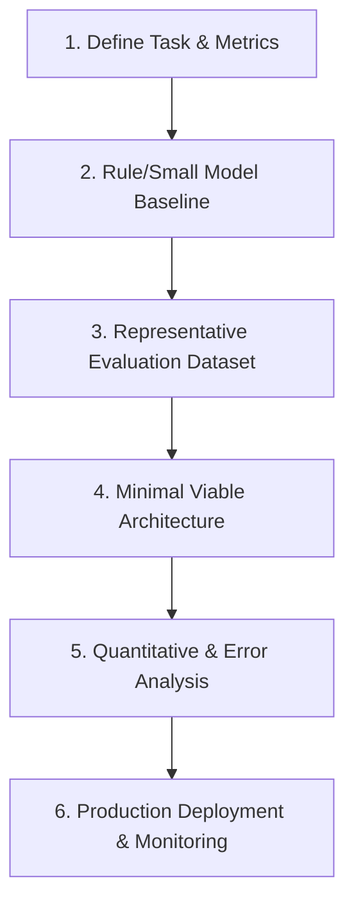
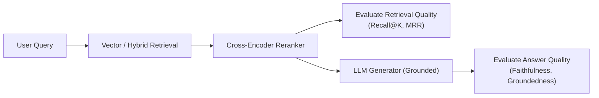

# AI and Machine Learning Engineering Standards

This reference governs the design, implementation, evaluation, and production deployment of AI/ML systems and LLM-powered applications.

---

## 1. The AI Engineering Lifecycle

For every AI-enabled feature, follow an empirical, iterative cycle:

1. **Task Definition & Success Criteria**: Quantify accuracy targets, maximum latency budgets (e.g., p95 < 800ms), and cost constraints per request.
2. **Model Selection Hierarchy**:
   - First consider: Deterministic algorithms, regular expressions, or heuristic rules.
   - Second: Specialized, lightweight models (e.g., fine-tuned BERT, small embeddings, local GGUF quantizations).
   - Third: Frontier foundation models (e.g., Gemini 1.5/2.0, Claude 3.5, GPT-4o) when reasoning, multi-turn tool calling, or multi-modal understanding is strictly necessary.
3. **Measurable Baselines**: Never claim an AI model is performant without establishing a benchmark against a simpler baseline or human evaluation.

---

## 2. LLM Application Engineering

### Structured Outputs & Schema Enforcement
- **Enforce Strict Schemas**: Never parse raw prose or hope the model outputs valid JSON. Use constrained decoding or SDK schema enforcement (e.g., Pydantic with `response_format` or Gemini `response_schema`).
- **Tool-Call Validation**: Validate every tool invocation argument against strict boundary validators before executing commands or queries. Treat tool inputs from the model as untrusted data.

### Prompt Engineering & Versioning
- **Treat Prompts as Code**: Version control all system instructions and prompts alongside application code.
- **Isolate Untrusted Content**: Clearly demarcate user-provided documents or external web content using XML/markdown tags (`<user_content>...</user_content>`) to mitigate prompt injection.
- **Streaming & Cancellation**: For interactive chat or long generations, implement server-sent events (SSE) or WebSocket streaming. Wire client-side disconnects to cancellation tokens to prevent wasted generation costs.

---

## 3. Retrieval-Augmented Generation (RAG) Architecture

Decouple and measure the two halves of RAG independently:

1. **Retrieval Evaluation**:
   - Measure **Recall@K**, **Precision@K**, and **MRR** (Mean Reciprocal Rank) on test queries.
   - Combine dense vector embeddings with sparse lexical search (BM25) for hybrid search.
2. **Generation Evaluation**:
   - Evaluate **Faithfulness** (no hallucinations beyond context) and **Answer Relevance**.
   - Require explicit citations (e.g., `[Doc 2, paragraph 3]`) for factual statements.

---

## 4. Local Models & Quantization

When running models on local or edge hardware:
- **Quantization Selection**:
  - `Q4_K_M`: Optimal balance between memory footprint and perplexity for 7B/14B models.
  - `Q8_0` or `FP16`: Use when high precision mathematical or code generation accuracy is mandatory.
- **Resource Constraints**:
  - Explicitly calculate VRAM requirements: Model weights + context window KV cache + runtime overhead.
  - Provide fallback logic or graceful degradation when hardware accelerator (GPU/MPS) is unavailable.
- **License Compliance**: Validate model licenses (Apache 2.0, MIT, Llama Community License, OpenRAIL) for commercial viability.

---

## 5. Classical ML & Computer Vision Pipelines

- **Data Hygiene**: Ensure strict temporal or split separation between training, validation, and test datasets to prevent data leakage.
- **Preprocessing Parity**: Ensure identical feature engineering and image transformations between training pipelines and real-time production inference.
- **Evaluation Beyond Accuracy**: On imbalanced datasets, evaluate Precision, Recall, F1-Score, and PR-AUC instead of misleading raw classification accuracy.
- **Model Registry & Drift**: Track model artifact hashes, training dataset versions, and monitor production predictions for feature drift.
