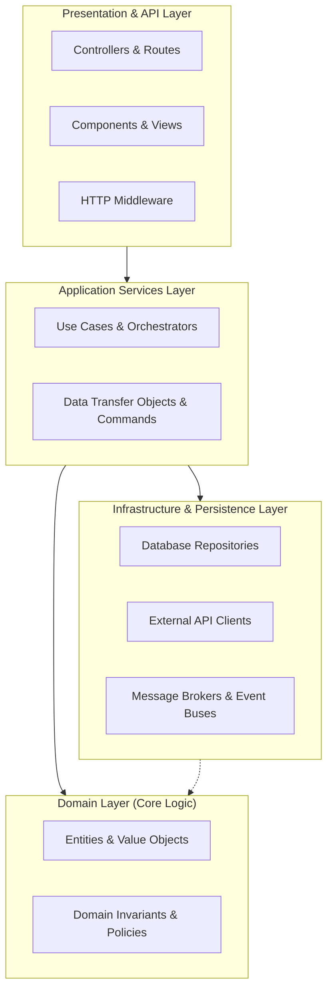

# Software Architecture Standards

This guide provides architectural principles and boundary patterns for building robust, scalable, and maintainable systems.

---

## 1. Core Architectural Principles

- **High Cohesion, Low Coupling**: Modules should group closely related logic together and expose minimal, explicit surfaces to other modules.
- **Composition over Inheritance**: Favor object composition and interfaces over deep class inheritance hierarchies. Inheritance tightly couples derived types to ancestor implementation details.
- **Dependency Inversion**: High-level policy modules should not depend directly on low-level infrastructure details (such as specific database drivers, file systems, or external HTTP clients). Both should depend on explicit abstractions/interfaces.
- **Separation of Concerns**: Isolate business logic from I/O, UI presentation, and persistence mechanisms.

---

## 2. Layered Boundary Model

For applications of moderate to high complexity, organize code into four distinct conceptual layers:

### Layer Responsibilities

1. **Domain Layer (Core Business Rules)**:
   - Contains business entities, domain types, validation rules, and pure computations.
   - **Zero external dependencies**: Must not import web frameworks, ORMs, or network libraries.
   - Deterministic and trivially unit-testable.

2. **Application Services Layer**:
   - Orchestrates domain entities to achieve specific user tasks/use cases.
   - Coordinates transactions, authentication context, and notifications.
   - Converts external commands/requests into domain operations.

3. **Infrastructure & Persistence Layer**:
   - Implements data access (SQL, NoSQL, ORM mappings), file storage, third-party API SDKs, and message brokers.
   - Adapts low-level infrastructure to domain repository interfaces.

4. **Presentation & API Layer**:
   - Handles HTTP/gRPC requests, routing, query parameter parsing, and serialization.
   - In frontend applications: UI components, design tokens, route navigation, and user input capture.

---

## 3. Modular Monolith vs. Distributed Services

| Aspect | Modular Monolith (Recommended Default) | Microservices (Requires Concrete Justification) |
| :--- | :--- | :--- |
| **Complexity** | Low operational overhead; single deployment unit; fast local iterations. | High operational overhead (service meshes, distributed tracing, network latency). |
| **Boundaries** | Enforced by language modules, packages, and dependency linters. | Enforced by network interfaces and separate codebases. |
| **Data Integrity** | ACID transactions within the single database where needed. | Eventual consistency, saga patterns, two-phase commits. |
| **Scaling** | Scales horizontally as a unit; vertical scaling for hot modules. | Independent scaling of specific services with divergent resource profiles. |

> **Rule**: Default to a clean modular monolith. Do not introduce microservices or distributed architectures unless driven by explicit organizational, compliance, or extreme independent scaling constraints.

---

## 4. Architectural Anti-Patterns to Avoid

- **God Classes & Mega-Modules**: Any single class or module that coordinates all operations, holds excessive state, or exceeds the 500-line limit.
- **Circular Dependencies**: When Module A imports Module B, and Module B directly or transitively imports Module A. Break circles by introducing an intermediary interface or extracting shared types into a domain module.
- **Leaky Abstractions**: Exposing internal database structures, ORM active records, or raw vendor payloads directly to frontend clients or domain logic.
- **Speculative Generality ("YAGNI")**: Writing extensible plugin architectures, abstract factories, or custom query builders for features that do not yet exist.
- **Anemic Domain Models with Sprawling Services**: Placing zero logic on data models while writing monolithic service classes that manipulate raw records procedurally across thousands of lines.
