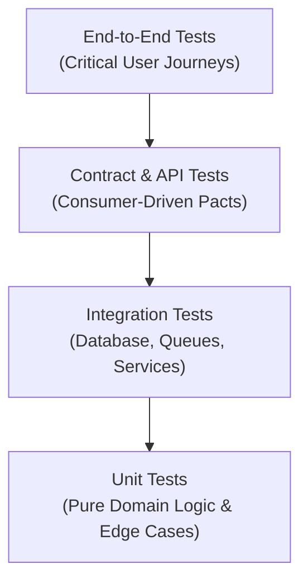

# Testing and Verification Standards

This reference defines testing methodologies, determinism requirements, and verification procedures across all tiers of the software stack.

---

## 1. The Verification Hierarchy

### Test Categories & Purposes

1. **Unit Tests (Fast & Isolated)**:
   - Target pure domain logic, mathematical calculations, validation rules, and state machines.
   - Run in-memory in milliseconds without external network, database, or filesystem dependencies.
2. **Integration Tests (Component Boundaries)**:
   - Verify interaction between application code and real or containerized infrastructure (PostgreSQL, Redis, local HTTP servers).
   - Test transaction commits/rollbacks, SQL queries, and serialization.
3. **Contract Tests (API Interoperability)**:
   - Validate that external services and microservice endpoints conform to agreed schemas and HTTP status contracts.
4. **End-to-End (E2E) Tests (Critical User Journeys)**:
   - Exercise full system journeys from UI to persistence for core revenue-critical workflows.
   - Keep suites small and focused to minimize flakiness and maintenance overhead.
5. **AI / Model Evaluations**:
   - Evaluate quantitative performance against reference golden datasets for quality, latency, token consumption, and hallucination rates.

---

## 2. Test Determinism & Anti-Flakiness Rules

- **Zero Network Flakes**: Never make live external HTTP calls during automated unit or integration tests. Mock external third-party services with deterministic stubs (e.g., WireMock, MSW, Nock).
- **No Arbitrary Sleep Timers**: Replace `sleep(1000)` or `time.sleep(2)` with explicit polling assertions (e.g., `waitFor(() => expect(...))`) with bounded timeouts.
- **Deterministic Clocks & Randomness**:
  - Inject clock interfaces or mock time (`jest.useFakeTimers()`, `timecop`, `freezegun`).
  - Seed random number generators when testing algorithms that consume random data.
- **Isolated Database State**: Run each integration test in an isolated transaction that rolls back upon completion, or truncate test tables between runs to prevent state pollution.

---

## 3. Testing Meaningful Behavior, Not Implementation Details

- **Test the Contract, Not the Internals**: Assert on outputs, return values, state transitions, and public events rather than private variable states or exact call counts of internal helper functions.
- **Test Matrix Requirements**: Every feature must test:
  - Normal happy path.
  - Edge cases (empty arrays, boundary numbers, 0, null, special characters).
  - Invalid input and validation failure handling.
  - Expected domain exceptions and error responses.
  - Security boundaries (unauthenticated and unauthorized access attempts).
- **Never Modify Tests to Mask Regressions**: Never delete or weaken an existing test assertion simply because a newly introduced change broke it. Confirm whether the change is an intentional breaking change or a regression.

---

## 4. Defect Reproduction & Regression Testing Workflow

When a bug is reported or discovered, strictly follow the 4-step regression cycle:

1. **Reproduce**: Write a failing test that isolates the bug and demonstrates the unexpected behavior. Run it to confirm failure (`Red`).
2. **Isolate & Fix**: Implement the minimal code correction in the application source (`Green`).
3. **Verify**: Rerun the failing test to confirm it now passes cleanly.
4. **Check Suite**: Run the full test suite to confirm no secondary regressions were introduced.
