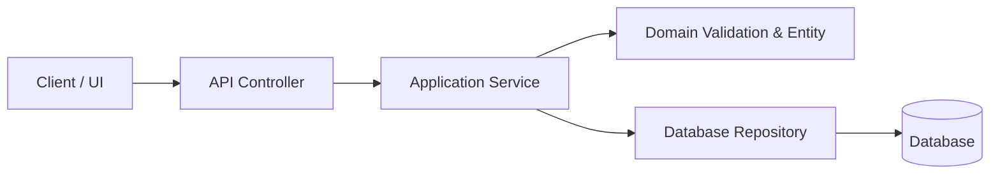

# [Feature/Task Title]: Implementation Plan

> **Author**: [Agent / Engineer Name]  
> **Status**: [Draft / In Review / Approved]  
> **Target Release / Milestone**: [Milestone]  

---

## 1. Executive Summary & Context
[Brief description of the problem, motivation, user impact, and overall objective.]

---

## 2. Requirements & Acceptance Criteria

### Functional Requirements
- [ ] [Req 1: e.g., System accepts user CSV upload and parses records]
- [ ] [Req 2: e.g., Invalid records trigger a 422 response with specific field errors]

### Non-Functional Requirements & Constraints
- [ ] **Performance**: [e.g., Process 10,000 records in < 2.0s]
- [ ] **Security**: [e.g., Enforce file size limit of 10MB, virus scan before storage]
- [ ] **Maintainability**: [e.g., All source files <= 500 physical lines]

---

## 3. Architecture & System Design

### Module Boundaries & Data Flow


### Proposed File Modifications & Additions
- `[NEW]` `src/modules/billing/invoice_service.ts`: Core orchestration logic (< 300 lines).
- `[NEW]` `src/modules/billing/invoice_calculator.ts`: Pure tax & total calculations.
- `[MODIFY]` `src/routes/billing_routes.ts`: Attach new invoice generation endpoint.

---

## 4. Dependencies & Integrations
- [List any newly introduced libraries, existing utility reuse, or third-party APIs with justification.]

---

## 5. Verification & Testing Strategy

### Unit Tests
- [ ] `tests/unit/invoice_calculator.test.ts`: Verify tax bracket edge cases and zero amounts.

### Integration Tests
- [ ] `tests/integration/billing_routes.test.ts`: Test full API journey with database rollback.

### 500-Line Policy Check
```bash
python3 scripts/check_source_line_limits.py --path src/modules/billing
```

---

## 6. Risks, Trade-Offs, & Mitigations
| Identified Risk | Severity | Mitigation Strategy |
| :--- | :--- | :--- |
| [e.g., Heavy CSV uploads consume server RAM] | High | Stream records line-by-line using chunked streams instead of loading entire file into memory. |
